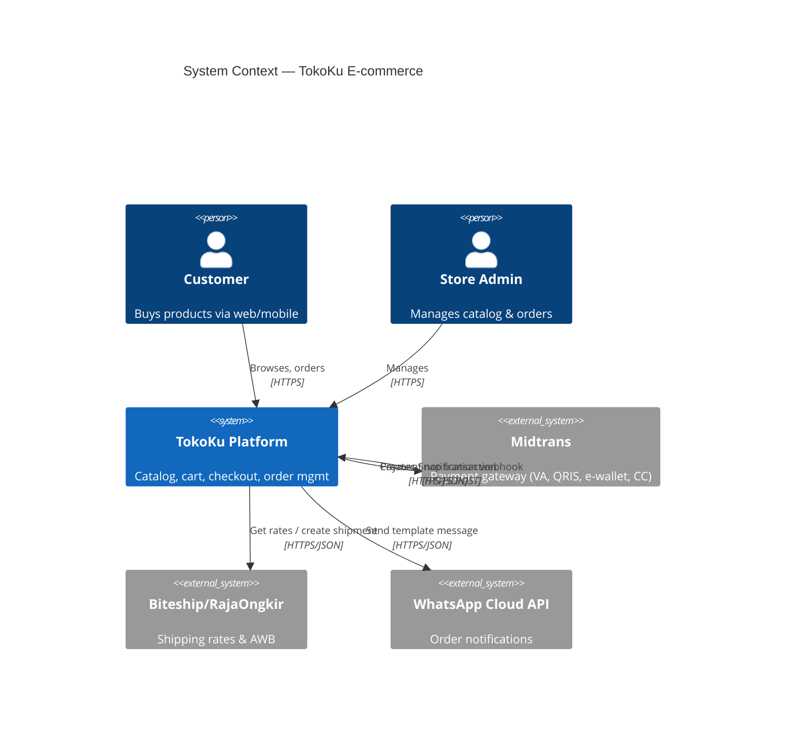
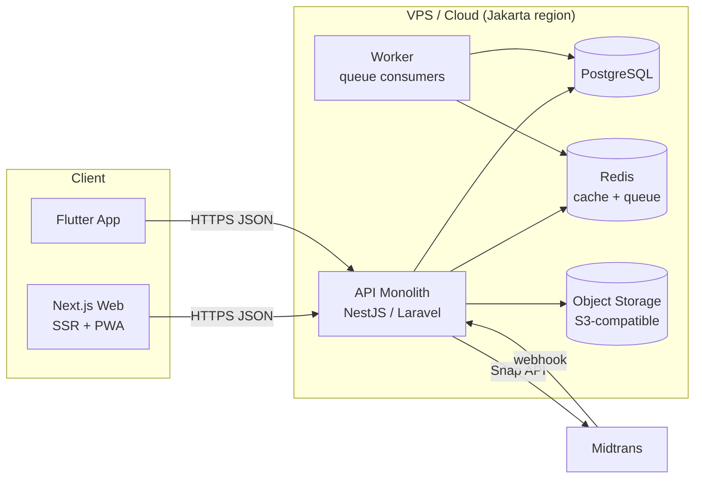
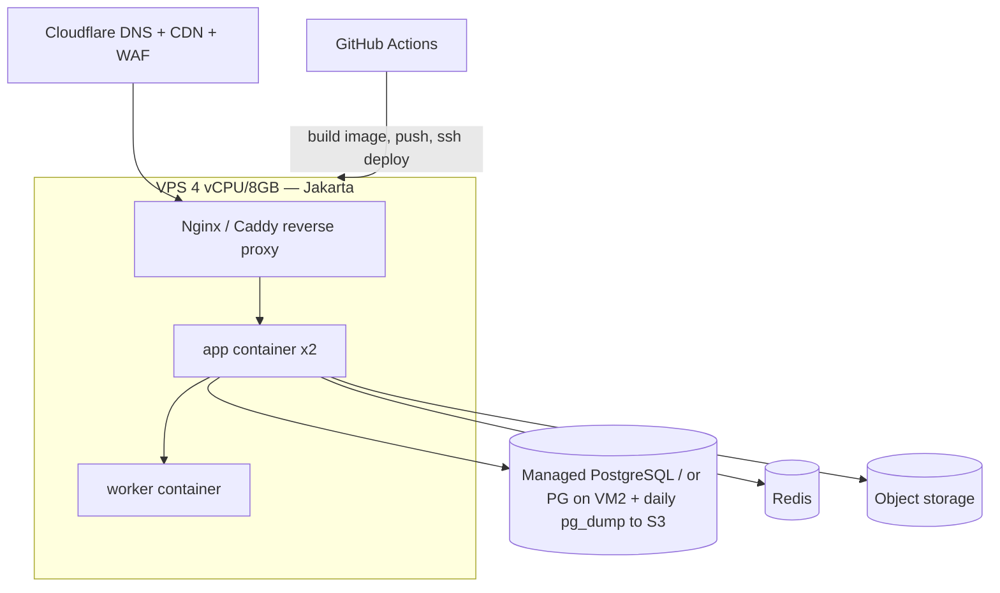
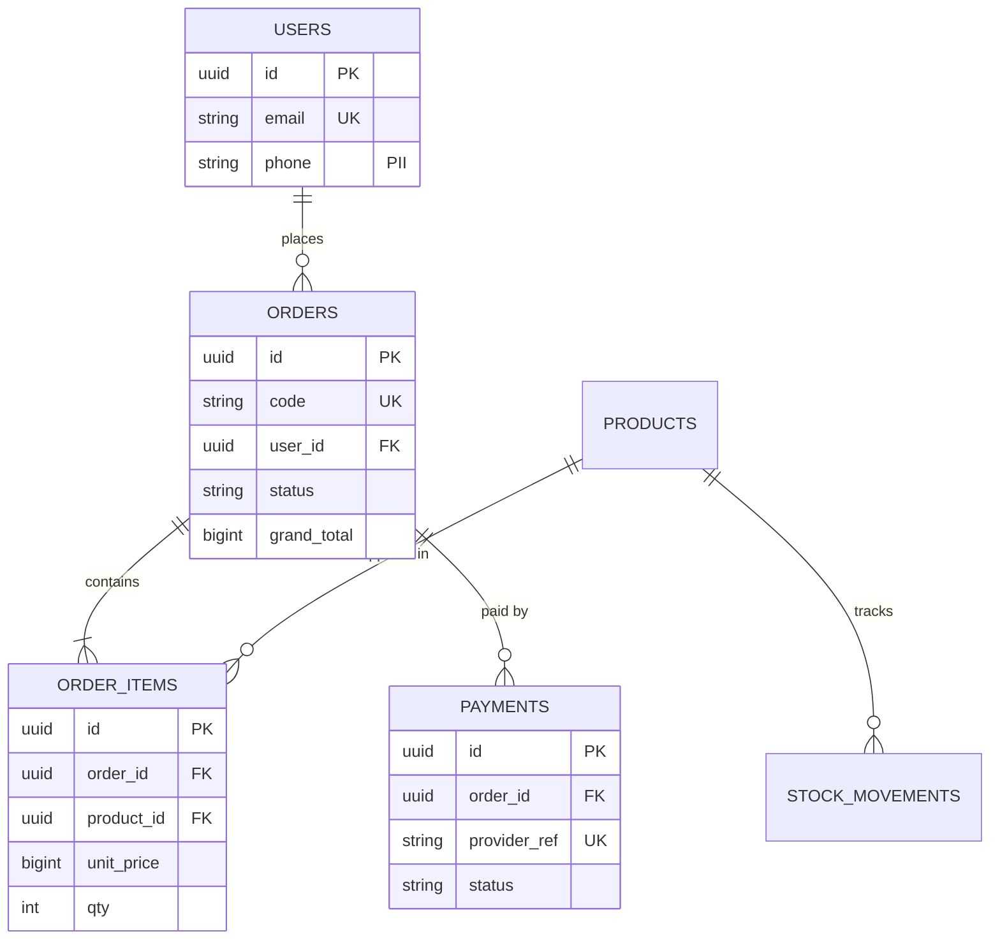

# 02 — System Architecture & Design for Client Projects (Playbook)

Agent-facing reference. Use it to design, document, and justify the architecture of a client system (Indonesian SME/startup context), and to produce diagrams, ERDs, and API contracts as text. Prices were checked Nov 2026 and are given only as "check before quoting" anchors.

---

## 0. TL;DR decision rules

1. **Start with a modular monolith + one PostgreSQL + object storage + a background-job queue.** Teams under ~10 devs, fewer than ~3 independently deployed domains, or unproven product: no microservices (Fowler's "MonolithFirst"; Sam Newman: microservices are "not the default").
2. **Write the NFRs as numbers before you pick a stack** (users, RPS, p95 latency, RPO/RTO, uptime %, data residency). No numbers means no architecture, only taste.
3. **Pick boring, hireable tech in Indonesia:** Laravel/PHP, Node/NestJS/Next.js, Go, Flutter/React Native, PostgreSQL/MySQL. Choose what the client's future maintainer can hire for in Jakarta/Surabaya/Bandung.
4. **Every significant decision gets an ADR** (one page, immutable, superseded rather than edited).
5. **Diagrams as code** (Mermaid / C4-PlantUML / Structurizr DSL / DBML) live in the repo `docs/` so they get versioned and reviewed with the code.
6. **Security and privacy are designed in from the start:** OWASP Top 10:2025 + ASVS level 1 minimum (L2 for payments/health/finance); UU PDP No. 27/2022 obligations (breach notice within **3×24 hours**, Pasal 46).
7. **Payments:** never trust the client redirect. Only a verified webhook (Midtrans signature / Xendit `x-callback-token`) changes order state, and the handler must be idempotent.
8. **Cost:** quote infra as a monthly line item to the client in Rupiah with a ±30% band, and re-check the vendor pricing page every time.

---

## 1. The architecture process for a client project (10 steps + deliverables)

| # | Step | Output artifact (in `docs/`) | Time on a 2–3-month SME project |
|---|------|------------------------------|-----------------------------------|
| 1 | Business context & requirements | `01-requirements.md` (goals, actors, use cases/user stories, constraints) | 2–5 days |
| 2 | Quality attributes / NFRs | `02-quality-attributes.md` (quality scenarios with numbers) | 0.5–1 day |
| 3 | Context diagram (C4 L1) | `c4-context.mmd` / `.puml` | 2 h |
| 4 | Container diagram (C4 L2) + tech choices | `c4-container.*` + ADRs | 0.5–1 day |
| 5 | Component diagrams (C4 L3) for complex containers only | `c4-component-<x>.*` | as needed |
| 6 | ADRs | `adr/0001-*.md` … | ongoing |
| 7 | Data model / ERD | `erd.dbml` or `erd.mmd` + data dictionary + PII classification | 1–3 days |
| 8 | API contracts | `openapi.yaml` (or GraphQL SDL) + webhook specs | 1–3 days |
| 9 | Infra / deployment / environments | `deployment.*`, IaC or runbook, CI/CD pipeline | 1–2 days |
| 10 | Security, privacy, observability, cost | `security.md` (threat model + ASVS checklist + UU PDP), `observability.md`, `cost-estimate.xlsx/md` | 1–2 days |

The whole set packs neatly into the **arc42** template (12 sections): 1 Introduction & Goals, 2 Constraints, 3 Context & Scope, 4 Solution Strategy, 5 Building Block View, 6 Runtime View, 7 Deployment View, 8 Crosscutting Concepts, 9 Architecture Decisions, 10 Quality Requirements, 11 Risks & Technical Debt, 12 Glossary. For small clients, deliver a "lean arc42" covering sections 1, 3, 4, 5, 7, 9, 10 and 11.

### Step 1: Requirements discovery checklist
- [ ] Business goal and success metric (e.g., "cut manual stock recap from 2 days to 0", "GMV Rp X/month").
- [ ] Actors/roles: customer, admin, kasir, gudang, owner, finance, super-admin (multi-tenant).
- [ ] Top 10 use cases/user stories, with MoSCoW priority.
- [ ] External systems: payment (Midtrans/Xendit/DOKU), shipping (RajaOngkir/Biteship/Shipper), WhatsApp (Meta Cloud API / Qontak / Wati / Fonnte), e-invoice/tax (Coretax e-Faktur via PJAP), accounting (Jurnal/Accurate), maps, email (SES/Brevo/Mailgun), SSO.
- [ ] Constraints: budget, deadline, team skill, existing hosting, regulation (UU PDP; PP 71/2019 for PSE; OJK/BI if fintech; Kemenkes if health data), language (ID/EN), devices (low-end Android, poor 3G/4G).
- [ ] Data: volume now and in 3 years, retention, migration from Excel/legacy, reporting needs.
- [ ] Ops: who maintains after handover? SLA? Support hours (WIB)?

### Step 2: Quality attributes (NFRs) as testable scenarios
Format (from SEI quality-attribute scenarios, as used in arc42 §10): **Source → Stimulus → Artifact → Environment → Response → Measure.**

| Attribute | Default target for SME client | Example scenario |
|---|---|---|
| Performance | p95 API < 500 ms; LCP < 2.5 s on 4G mid-range Android | 200 concurrent users at checkout → p95 < 800 ms |
| Availability | 99.5% (~3.6 h/month downtime); 99.9% only if paid for | Single VM failure → service restored < 1 h |
| Scalability | 10× current load without redesign | Ramadan/Harbolnas flash sale at 10× normal traffic |
| Recoverability | RPO ≤ 24 h (daily backup), RTO ≤ 4 h; tighter for payments | DB corrupted → restore from last PITR within 2 h |
| Security | OWASP Top 10 covered, ASVS L1 (L2 if money/health) | Pentest finds no High/Critical before go-live |
| Privacy | UU PDP compliant; PII encrypted at rest; data-subject rights | Delete/export request fulfilled within SLA |
| Maintainability | New dev productive in < 1 week; test coverage on domain logic | README + `make dev` brings up the stack |
| Usability/i18n | Bahasa Indonesia first, IDR format `Rp1.250.000`, WIB/WITA/WIT timezones | — |
| Cost | Infra ≤ Rp X/month at launch | — |

**Rule:** if the client cannot say which of availability / cost / time-to-market matters most, rank them together. Trade-offs flow from that ranking. The Well-Architected frameworks ask the same thing.

### Well-Architected pillars (use as review checklist)
- **AWS (6):** Operational Excellence, Security, Reliability, Performance Efficiency, Cost Optimization, Sustainability.
- **Azure (5):** Reliability, Security, Cost Optimization, Operational Excellence, Performance Efficiency.
- **Google Cloud:** Operational excellence; Security, privacy & compliance; Reliability; Cost optimization; Performance optimization (plus a sustainability perspective).
- Pre-go-live review: one question per pillar. Who gets paged? What is encrypted, and who has prod access? What happens when the DB dies? What is p95 under load? What is the monthly bill and the alert threshold?

### 12-Factor App (Heroku, 12factor.net): enforce on every service
1 Codebase (one repo per deployable), 2 Dependencies (declared, lockfile), 3 Config in env vars (never in git), 4 Backing services as attached resources (DB/Redis/S3 via URL), 5 Build/Release/Run separated, 6 Stateless processes (sessions in Redis/DB, files in S3), 7 Port binding, 8 Concurrency via process types (web/worker), 9 Disposability (fast start, graceful shutdown), 10 Dev/prod parity (Docker Compose), 11 Logs as event streams (stdout), 12 Admin processes as one-off tasks (migrations).

---

## 2. C4 model: diagrams the agent should produce

C4 (Simon Brown, c4model.com) has 4 levels: **1 System Context → 2 Container → 3 Component → 4 Code**, plus supporting diagrams: **System Landscape, Dynamic, Deployment**. A "container" means a separately deployable/runnable unit (web app, mobile app, API, DB, queue). It is not a Docker container. Rules:
- Every box: name, [type/technology], one-line responsibility. Every arrow: verb phrase plus protocol ("Places orders [HTTPS/JSON]").
- Include a title, a legend, and a scope. Clients need L1 and L2. Devs need L2, selected L3, and Deployment. L4 is almost never worth drawing by hand.
- Common mistakes Brown lists: mixing abstraction levels, unlabeled arrows, using "container" to mean Docker, treating C4 as a mandated notation (it is a set of abstractions; notation is free).

### 2.1 Mermaid C4 (renders on GitHub/GitLab/Notion-ish; experimental but fine)


### 2.2 Plain Mermaid flowchart (most portable; use when C4 syntax fails to render)


### 2.3 C4-PlantUML (best fidelity; render with PlantUML server/Kroki)
```plantuml
@startuml
!include https://raw.githubusercontent.com/plantuml-stdlib/C4-PlantUML/master/C4_Container.puml
LAYOUT_WITH_LEGEND()
title Container — Lumii AI Business Assistant
Person(owner, "UMKM Owner", "Asks business questions via WhatsApp/web")
System_Boundary(l, "Lumii") {
  Container(web, "Web App", "Next.js", "Chat UI, dashboard, doc upload")
  Container(api, "API", "FastAPI (Python)", "Auth, chat orchestration, tenancy")
  Container(ing, "Ingestion Worker", "Python + queue", "Parse, chunk, embed documents")
  ContainerDb(db, "PostgreSQL + pgvector", "Postgres 16", "Tenants, users, chats, chunks+embeddings")
  ContainerDb(obj, "Object Storage", "S3-compatible", "Raw uploaded files")
}
System_Ext(llm, "LLM API", "OpenAI/Anthropic/Gemini")
System_Ext(wa, "WhatsApp Cloud API", "Messaging channel")
Rel(owner, web, "Uses", "HTTPS")
Rel(owner, wa, "Chats")
Rel(wa, api, "Webhook", "HTTPS")
Rel(web, api, "Calls", "HTTPS/JSON, SSE")
Rel(api, db, "Reads/writes, vector search", "SQL")
Rel(api, llm, "Completions/embeddings", "HTTPS")
Rel(ing, obj, "Reads files")
Rel(ing, db, "Writes chunks + vectors")
@enduml
```

### 2.4 Structurizr DSL (one model, many views; best for living docs)
```
workspace "TukaKu" {
  model {
    user = person "User"
    sys = softwareSystem "TukaKu" {
      app = container "Mobile App" "Flutter"
      api = container "API" "Go / Fiber"
      db  = container "Database" "PostgreSQL" "" "Database"
    }
    pay = softwareSystem "Xendit" "" "External"
    user -> app "Uses"
    app -> api "JSON/HTTPS"
    api -> db "SQL"
    api -> pay "Creates invoices"
    pay -> api "Webhook (x-callback-token)"
  }
  views {
    systemContext sys { include * autolayout lr }
    container sys { include * autolayout lr }
    theme default
  }
}
```

### 2.5 Sequence diagram (runtime view): payment flow
```mermaid
sequenceDiagram
  autonumber
  participant C as Customer App
  participant A as API
  participant DB as DB
  participant M as Midtrans
  C->>A: POST /orders (cart)
  A->>DB: insert order status=PENDING (idempotency key)
  A->>M: POST /snap/v1/transactions (order_id, gross_amount)
  M-->>A: snap token + redirect_url
  A-->>C: token
  C->>M: pays (VA/QRIS/e-wallet)
  M->>A: POST /webhooks/midtrans (notification)
  A->>A: verify signature_key = SHA512(order_id+status_code+gross_amount+server_key)
  A->>M: (optional) GET /v2/{order_id}/status to double-check
  A->>DB: upsert payment; transition order PENDING→PAID (only if not already)
  A-->>M: 200 OK
  A-)C: push/WA "Pembayaran diterima"
```

### 2.6 Deployment diagram (Mermaid)


---

## 3. Architecture Decision Records (ADRs)

From joelparkerhenderson/architecture-decision-record (17k★). A good ADR has a **rationale**, is **specific** (one decision per ADR), carries **timestamps**, and is **immutable**: you amend it or supersede it with a new ADR, never rewrite it. Store as `docs/adr/NNNN-kebab-title.md`. Tools: `adr-tools` (npryce, 5.8k★), MADR template (adr/madr, 2.6k★).

**Nygard template (default; ≤1 page):**
```markdown
# ADR-0003: Use PostgreSQL with pgvector instead of a separate vector DB
Date: 2026-11-08
Status: Accepted   (Proposed | Accepted | Deprecated | Superseded by ADR-00XX)
## Context
Lumii needs semantic search over <5M chunks per deployment; team of 2; budget < Rp2jt/month infra.
Already need Postgres for transactional data. Tenancy isolation required.
## Decision
Store embeddings in Postgres (pgvector, HNSW index), row-level tenant_id filter + RLS.
## Consequences
+ One DB to back up/secure; transactional consistency between docs and chunks.
+ No extra vendor bill.
- Vector search competes with OLTP for CPU; revisit at >10M chunks or p95 > 300 ms (fitness function).
- Fewer ANN tuning knobs than dedicated engines (Qdrant/Weaviate/Milvus).
## Alternatives considered
Pinecone (vendor cost, data leaves ID region), Qdrant self-host (extra ops).
```
**Typical ADR list for a client project:** language/framework; monolith vs services; database; hosting/region; auth approach (session vs JWT, OAuth provider); multi-tenancy model; payment gateway; file storage; queue/job runner; API style (REST vs GraphQL); mobile approach (Flutter vs RN vs PWA); CI/CD; observability stack; backup policy.

**Y-statement (one-liner, Zimmermann):** "In the context of <use case>, facing <concern>, we decided for <option> and neglected <other options>, to achieve <quality>, accepting <downside>."

---

## 4. Monolith vs microservices: decision rules

**Default: modular monolith.** One deployable, but code organized by bounded context (`modules/catalog`, `modules/orders`, `modules/payments`). Modules talk through explicit interfaces/events and do not share tables across modules.

Split a module into a service **only when ≥2 of these hold:**
- [ ] It needs **independent scaling** with a materially different profile (e.g., AI ingestion workers, image processing, real-time chat sockets).
- [ ] It needs a **different tech/runtime** (Python ML next to a PHP/Node core).
- [ ] A **separate team** owns it and release coupling actually slows the team down (Conway's law).
- [ ] It has **different availability/security requirements** (payment vault, PCI scope isolation).
- [ ] The boundary is **stable and well understood**: you have run it as a module for months.

**Do not split when:** team < ~8 devs, domain still changing, no CI/CD + centralized logging/tracing yet, or no one can run Kubernetes or an equivalent. Microservices need, at minimum: service discovery/ingress, distributed tracing, per-service DB, an async messaging strategy, contract tests, and automated deployment. Fowler calls this the "microservice premium."

**microservices.io patterns worth knowing (Chris Richardson):** Database per service, API Gateway / Backend-for-Frontend, **Saga** (orchestration vs choreography) for cross-service transactions, **Transactional Outbox** (write the event to an outbox table in the same DB transaction, relay to the broker), CQRS, Event sourcing, **Strangler Fig** (incrementally replace a legacy app behind a facade), Circuit Breaker, Idempotent Consumer, Service Mesh, Sidecar, Health Check API, Log aggregation, Distributed tracing. **Outbox + Idempotent Consumer are useful even inside a monolith** (e.g., "order paid → send WA + deduct stock").

**Sam Newman's decomposition guidance:** extract by business capability, start with something low-risk on the edge, use the strangler-fig pattern, split the code before you split the database, and know *why* you're doing it (the goal decides the path).

---

## 5. Data modeling & ERD

### 5.1 Process
1. List **entities** from nouns in the use cases; **relationships** from the verbs.
2. Determine cardinality (1:1, 1:N, M:N → junction table).
3. Normalize to **3NF** for OLTP. Denormalize deliberately (snapshot `price`, `product_name` into `order_items`; caching counters) and record it in an ADR or comment.
4. Classify every column: **PII / sensitive PII (data pribadi spesifik:** health, biometric, genetic, criminal records, child data, personal financial data, per UU PDP Pasal 4) / public. Mark it in the ERD notes.
5. Add audit and lifecycle fields; define indexes from query patterns; define retention.

### 5.2 Conventions (decide once, put in ADR)
- Tables plural snake_case (`order_items`); PK `id` = **UUIDv7/ULID** (sortable, safe to expose) or `bigint identity` internally + `public_id`.
- Money: **`bigint` in smallest unit** (IDR has no practical decimals, so store rupiah as integer) or `numeric(18,2)`; **never float**. Store `currency` if multi-currency.
- Time: `timestamptz` stored in UTC; render in Asia/Jakarta (WIB), Asia/Makassar (WITA), Asia/Jayapura (WIT).
- `created_at`, `updated_at`, optional `deleted_at` (soft delete; but PDP erasure may require hard delete or anonymization).
- Status as enum/check constraint + state machine in code (`PENDING → PAID → PACKED → SHIPPED → COMPLETED / CANCELLED / REFUNDED`).
- Multi-tenant: `tenant_id` on every tenant-owned table + composite indexes `(tenant_id, …)` + Postgres RLS.
- Indonesian specifics: NIK (16 digits, sensitive; encrypt + mask), NPWP (16 digits since the NIK-NPWP integration), phone in E.164 `+62…`, address hierarchy provinsi → kabupaten/kota → kecamatan → kelurahan/desa + kode pos (use the BPS/Kemendagri region codes table).
- Inventory: never store only a "stock" number. Keep a **stock_movements ledger** (IN/OUT/ADJUST/TRANSFER with reference) and derive or cache the balance. Same for money: ledger/journal entries, double-entry for ERP.

### 5.3 DBML (dbdiagram.io; holistics/dbml 3.7k★): e-commerce core
```dbml
Project tokoku { database_type: 'PostgreSQL' }

Table users {
  id uuid [pk]
  name varchar [not null]
  email varchar [unique]
  phone varchar [note: 'E.164 +62..., PII']
  password_hash varchar
  created_at timestamptz [default: `now()`]
}
Table products {
  id uuid [pk]
  sku varchar [unique, not null]
  name varchar [not null]
  price bigint [not null, note: 'IDR, integer rupiah']
  is_active boolean [default: true]
}
Table orders {
  id uuid [pk]
  code varchar [unique, note: 'INV/2026/11/000123 shown to customer']
  user_id uuid [ref: > users.id]
  status order_status [not null]
  subtotal bigint
  shipping_fee bigint
  grand_total bigint [not null]
  created_at timestamptz
  indexes { (user_id, created_at) }
}
Table order_items {
  id uuid [pk]
  order_id uuid [ref: > orders.id]
  product_id uuid [ref: > products.id]
  product_name varchar [note: 'snapshot']
  unit_price bigint [note: 'snapshot']
  qty int [not null]
}
Table payments {
  id uuid [pk]
  order_id uuid [ref: > orders.id]
  provider varchar [note: 'midtrans|xendit']
  provider_ref varchar [unique, note: 'transaction_id / invoice id']
  method varchar [note: 'qris, bca_va, gopay...']
  status varchar
  amount bigint
  raw_payload jsonb [note: 'last webhook, for audit']
  paid_at timestamptz
}
Table stock_movements {
  id bigint [pk, increment]
  product_id uuid [ref: > products.id]
  qty int [note: '+in / -out']
  reason varchar [note: 'PURCHASE|SALE|ADJUST|RETURN']
  ref_type varchar
  ref_id uuid
  created_at timestamptz
}
Enum order_status { PENDING PAID PACKED SHIPPED COMPLETED CANCELLED REFUNDED }
```

### 5.4 Mermaid ERD (same model, renders in GitHub markdown)

Mermaid cardinality: `||` exactly one, `o|` zero or one, `}|` one or more, `}o` zero or more.

**Agent workflow:** generate DBML (most precise: types, indexes, enums, notes) → convert to SQL migration (`@dbml/cli`: `dbml2sql schema.dbml --postgres`) or ORM schema (Prisma/Drizzle/Laravel migrations) → also emit the Mermaid ERD for the client doc. Review checklist: every FK indexed, every money column integer/numeric, every query in the top-10 use cases has an index, PII columns flagged, tenant_id everywhere (if SaaS).

---

## 6. API contracts

### 6.1 Style choice
| Need | Choose |
|---|---|
| CRUD business app, public/partner API, mobile + web | **REST + OpenAPI 3.1** (default) |
| Many client types with very different data shapes, nested reads, a strong frontend team | **GraphQL** (+ persisted queries, depth/complexity limits, DataLoader for N+1) |
| Internal service-to-service, high throughput, polyglot | **gRPC** |
| Server → client real-time (chat, AI streaming tokens) | **SSE** for streaming LLM output; **WebSocket** for bidirectional chat |
| Notify third parties of events | **Webhooks** (signed, retried, idempotent) |

### 6.2 REST conventions (synthesized from Microsoft REST API Guidelines 23k★, Zalando RESTful API Guidelines 3.3k★)
- Resources are plural nouns: `GET /v1/orders`, `GET /v1/orders/{id}`, `POST /v1/orders`, `PATCH /v1/orders/{id}`, sub-resources `/v1/orders/{id}/items`. Actions that aren't CRUD: `POST /v1/orders/{id}:cancel` or `/v1/orders/{id}/cancellation`.
- JSON field case: pick one (`snake_case` per Zalando or `camelCase` per Microsoft) and never mix.
- Status codes: 200/201(+Location)/204; 400 validation; 401 unauthenticated; 403 forbidden; 404; 409 conflict/state; 422 semantic validation; 429 rate limit; 5xx server errors only.
- Errors: **RFC 9457 Problem Details** `application/problem+json` → `{type, title, status, detail, instance, errors:[{field, message}]}`. Localize `detail` (id/en) via `Accept-Language`.
- Pagination: **cursor-based** (`?limit=20&cursor=…` → `next_cursor`) for feeds and large tables; offset for small admin tables. Filtering `?status=PAID&created_from=…`, sorting `?sort=-created_at`.
- **Idempotency:** `Idempotency-Key` header on POSTs that create money/side effects. Store key → response for 24 h.
- Concurrency: `ETag` + `If-Match` for updates, or a `version` column (optimistic locking).
- Versioning: **URL major version `/v1`** (simplest for clients/mobile). Make only additive changes within a version. Breaking change means `/v2` plus a deprecation period with `Deprecation`/`Sunset` headers. Mobile apps stay in the wild for months, so support N-1 and use a force-update endpoint (`GET /v1/app-config` → `min_version`).
- Auth: OAuth2/OIDC (Auth0/Clerk/Keycloak/Supabase Auth/Firebase Auth) or first-party session cookies (`HttpOnly; Secure; SameSite=Lax`) for web. Short-lived access JWT (≤15 min) + rotating refresh token for mobile. API keys for server-to-server (hashed at rest, scoped).
- Time: ISO-8601 with offset (`2026-11-08T10:00:00+07:00`) or UTC `Z`. Money: integer + currency.

### 6.3 OpenAPI 3.1 skeleton (contract-first; generate SDKs/mocks from it)
```yaml
openapi: 3.1.0
info: { title: TokoKu API, version: 1.0.0 }
servers: [{ url: https://api.tokoku.id/v1 }]
components:
  securitySchemes:
    bearer: { type: http, scheme: bearer, bearerFormat: JWT }
  schemas:
    Money: { type: integer, description: "IDR, rupiah", example: 125000 }
    Order:
      type: object
      required: [id, code, status, grand_total]
      properties:
        id: { type: string, format: uuid }
        code: { type: string, example: "INV/2026/11/000123" }
        status: { type: string, enum: [PENDING, PAID, PACKED, SHIPPED, COMPLETED, CANCELLED, REFUNDED] }
        grand_total: { $ref: '#/components/schemas/Money' }
    Problem:
      type: object
      properties: { type: {type: string}, title: {type: string}, status: {type: integer}, detail: {type: string} }
security: [{ bearer: [] }]
paths:
  /orders:
    post:
      summary: Create order from cart
      parameters:
        - { name: Idempotency-Key, in: header, required: true, schema: { type: string } }
      responses:
        '201': { description: Created, content: { application/json: { schema: { $ref: '#/components/schemas/Order' } } } }
        '422': { description: Validation error, content: { application/problem+json: { schema: { $ref: '#/components/schemas/Problem' } } } }
  /webhooks/midtrans:
    post:
      security: []
      summary: Midtrans HTTP notification (verify signature_key)
      responses: { '200': { description: Acknowledged } }
```
Tooling: Swagger UI / Redoc / Scalar for docs; Prism for mock servers; `openapi-generator` or `orval` for clients; Spectral for linting; Schemathesis for contract fuzzing.

### 6.4 GraphQL guardrails
Schema-first SDL in repo; Relay-style cursor connections; mutations return payload + `userErrors`; disable introspection in prod for private APIs; depth/complexity limits; persisted queries for mobile; authorization in resolvers/data layer, not only at the gateway; evolve by deprecating fields (`@deprecated`) rather than versioning.

### 6.5 Webhooks (consuming & emitting)
- **Midtrans:** verify `signature_key == SHA512(order_id + status_code + gross_amount + ServerKey)`. Midtrans docs say to handle notifications **idempotently** (duplicates can happen; key on order ID) and to use HTTPS without self-signed certs. Optionally re-query the Get Status API before fulfilling. Map `transaction_status` (`capture`/`settlement` → paid; `pending`; `deny`/`cancel`/`expire` → failed; `refund`/`partial_refund`).
- **Xendit:** compare the `x-callback-token` header to the dashboard token (constant-time compare); handle duplicate webhooks (dedupe on event/invoice id); respond 2xx fast and process async.
- General: persist raw payload → enqueue → return 200 within a few seconds; state transitions guarded (`UPDATE … WHERE status='PENDING'`); reconciliation job daily against the provider's settlement report.
- Emitting your own webhooks: HMAC-SHA256 signature header + timestamp (replay window 5 min), retries with exponential backoff, event id for dedupe, and a delivery log UI.

---

## 7. Security & privacy by design

### 7.1 OWASP Top 10:2025 → concrete controls
| # | Risk | Default controls |
|---|---|---|
| A01 | Broken Access Control | Deny by default; check object ownership/tenant on **every** query (IDOR); policy layer (Laravel Policies, CASL, Casbin, Postgres RLS); test "user A reads B's order" |
| A02 | Security Misconfiguration | Hardened images, no debug in prod, security headers (CSP, HSTS), closed DB ports, least-privilege IAM, private buckets |
| A03 | Software Supply Chain Failures | Lockfiles, Dependabot/Renovate, `npm audit`/`composer audit`/`pip-audit`, pin GitHub Actions by SHA, SBOM for enterprise clients |
| A04 | Cryptographic Failures | TLS everywhere; Argon2id/bcrypt passwords; AES-256 field encryption for NIK/financial data; KMS/secret manager; no secrets in git |
| A05 | Injection | ORM/parameterized queries, output encoding, validate input (zod/Joi/FormRequest/Pydantic); for LLM apps treat prompt injection as injection (see §8.5) |
| A06 | Insecure Design | Threat modeling (STRIDE) per feature; abuse cases (voucher abuse, OTP spam); rate limits |
| A07 | Authentication Failures | MFA for admins, OTP rate limits, lockout/backoff, secure session handling, no user enumeration |
| A08 | Software or Data Integrity Failures | Signed webhooks, verified CI artifacts, no unsafe deserialization |
| A09 | Security Logging & Alerting Failures | Audit log of auth/admin/payment events; alerts on anomalies; logs without PII/secrets |
| A10 | Mishandling of Exceptional Conditions | Fail closed, global error handler, no stack traces to users, timeouts/retries with limits |

**OWASP ASVS (v5.0, 3.8k★ repo):** use as the acceptance checklist. **L1** for every app (the baseline, testable black-box); **L2** for apps with sensitive data or transactions (most e-commerce/ERP/fintech clients); **L3** for critical systems. Put the chosen level in the contract/SoW. OWASP Cheat Sheet Series (34k★) has implementation details per topic.

### 7.2 UU PDP (UU No. 27/2022 Pelindungan Data Pribadi): architecture implications
Fully enforceable since **Oct 2024** (2-year transition). Your client is usually the **Pengendali Data (controller)**. You as developer/host are often the **Prosesor Data (processor)**, so put a data processing agreement in the contract.
- **Lawful basis & consent** (persetujuan): store consent records (what, when, version of privacy policy, channel) in a `consents` table, and let users withdraw.
- **Data minimization & purpose limitation:** collect NIK/KTP photos only if actually needed.
- **Data subject rights:** access, correction, deletion/erasure, withdrawal of consent, objection to automated decisions. Build admin tooling plus `export my data` and `delete account` flows, and log fulfillment.
- **Specific (sensitive) data** (Pasal 4: health, biometric, genetic, criminal records, children's data, personal financial data, etc.): encrypt, restrict access, run a DPIA (penilaian dampak).
- **Breach notification:** written notice to data subjects and the authority **within 3×24 hours** (Pasal 46), stating what data leaked, when/how, and remediation. Requires: audit logs, an incident runbook, and contact data. Put it in the SLA.
- **DPO** (Pejabat/Petugas Pelindungan Data Pribadi, Pasal 53) is required for public-service processing, large-scale systematic monitoring, or large-scale sensitive data. Note the Constitutional Court ruling 151/PUU-XXII/2024 on Pasal 53 reading of the criteria. Verify current interpretation with counsel.
- **Cross-border transfer** (Pasal 56): allowed only if the destination has equal-or-higher protection, else adequate safeguards, else consent. **Practical rule:** host in a Jakarta region (AWS ap-southeast-3, GCP asia-southeast2, Azure Indonesia Central, or local providers such as Biznet Gio / IDCloudHost / Telkom). Disclose LLM/API vendors that process data abroad in the privacy policy.
- **PSE registration** (PP 71/2019 + Permenkominfo 5/2020): private electronic system operators serving Indonesian users must register (PSE Lingkup Privat) via OSS. Flag it to the client.
- **Retention & deletion:** a retention table per data class; scheduled purge/anonymize jobs; backups expire on a schedule.
- Sector rules: fintech/payments (OJK, BI) and health (Kemenkes/SATUSEHAT) carry extra residency/security requirements. Check before quoting.

### 7.3 Minimum security baseline (every project)
Secrets in env/secret manager · HTTPS + HSTS · Cloudflare/WAF + rate limiting · admin behind MFA (and IP allowlist/VPN if possible) · RBAC matrix documented · audit_logs table (who, what, when, before/after) · daily encrypted backups + **tested restore** · dependency scanning in CI · separate staging/prod with prod data never copied raw to staging (mask PII) · pre-launch pentest or at least OWASP ZAP baseline scan.

---

## 8. Reference architectures for common Indonesian client systems

### 8.1 Company profile + CMS (Rp5–30 jt projects)
- **Stack:** Astro/Next.js static or ISR + headless CMS (Strapi 73k★, Payload 46k★, or Sanity/Contentful SaaS), or plain **WordPress** if the client wants to self-edit and has a local agency ecosystem.
- **Hosting:** Vercel/Netlify/Cloudflare Pages (free tier → Vercel Pro $20/user/month) or a shared hosting/VPS for WordPress. Cloudflare in front.
- **Must-haves:** SEO (meta, sitemap, schema.org LocalBusiness), WhatsApp click-to-chat, Google Business Profile, contact form → email/WA + spam protection (Turnstile), analytics (GA4), Bahasa/English i18n, fast on mobile.
- **Architecture:** no custom backend unless needed. Forms go to a serverless function. Images on CDN.

### 8.2 E-commerce / marketplace with Midtrans/Xendit
- **Buy vs build:** small single-brand shop → Shopify/Woo/hosted platforms first. Custom only for unique flows (B2B pricing, reseller/dropship tiers, multi-vendor). For custom work consider Medusa (37k★, Node) or Saleor (24k★, Python/GraphQL) as headless commerce engines.
- **Containers:** Next.js storefront (SSR for SEO) · admin dashboard · API modular monolith (catalog, cart, checkout, orders, payments, shipping, promotions, inventory, notifications) · worker (webhooks, emails/WA, stock sync, reports) · PostgreSQL · Redis (cache, sessions, queue, rate limit) · object storage + CDN for images · search (Postgres FTS → Meilisearch/Typesense when catalog >50k SKUs).
- **Payments:** Midtrans Snap or Xendit Invoice/Payment Links for the fastest integration. The order state machine is driven **only by verified webhooks**. Daily reconciliation. Reserve stock at checkout with a TTL equal to the payment expiry (e.g., VA 24 h); release on `expire`.
  - Midtrans published rates (check before quoting): VA Rp4.000/trx, QRIS 0.7%, GoPay 2%, ShopeePay 1.5%, credit card 2.9% + Rp2.000, Indomaret/Alfa Rp5.000. Xendit publishes comparable per-method fees; check its pricing page.
- **Marketplace (multi-vendor) extras:** vendor onboarding/KYC, split payments/escrow (Xendit xenPlatform / Midtrans split features; confirm licensing, since holding funds can count as a regulated activity), commission ledger, payouts/disbursement, dispute flow, per-vendor shipping.
- **Shipping:** Biteship/RajaOngkir/Shipper aggregator API for rates + AWB + tracking webhooks.
- **Flash-sale readiness:** CDN cache for product pages, Redis atomic stock decrement (`DECR` / Lua) or `SELECT … FOR UPDATE SKIP LOCKED`, a queue for order creation, load test (k6) at 10× expected.

### 8.3 ERP / POS / inventory (UMKM to mid-size)
- **Buy vs build:** evaluate **Odoo** (56k★; Community vs Enterprise licensing) or **ERPNext/Frappe** (41k★, GPL) plus Indonesian SaaS (Jurnal, Accurate, Moka, Majoo, Pawoon). Build custom only when the workflow is the differentiator, and integrate with accounting rather than rebuilding it.
- **Architecture:** modular monolith (Laravel/NestJS/Django) with modules: master data (items, UoM conversion, suppliers, customers), purchasing (PO → GRN), sales (SO → DO → invoice), inventory (multi-warehouse, **stock ledger**, batch/expiry, FIFO/average costing), POS, finance (double-entry journal, AR/AP), reports, RBAC by branch.
- **POS offline-first:** the PWA or Flutter app keeps a local DB (IndexedDB/SQLite) and a sync queue with client-generated UUIDs. The server resolves conflicts (stock may go negative, then flag it). Thermal printer via ESC/POS (Bluetooth/USB). QRIS static or dynamic via payment gateway.
- **Tax:** PPN invoices (e-Faktur via Coretax/PJAP integration), NPWP 16-digit, rounding rules. Get a tax consultant to sign off on formulas.
- **Reporting:** read replica or nightly materialized views. Export Excel because clients will ask for it.

### 8.4 Booking / SaaS multi-tenant (clinic, salon, futsal, kos, course)
- **Tenancy models:** (a) **shared DB, `tenant_id` column + RLS** (default, cheapest); (b) schema-per-tenant (stronger isolation, migrations ×N); (c) DB-per-tenant (enterprise/regulated tenants, premium tier). Can be hybrid: pooled for small plans, silo for enterprise.
- **Components:** tenant resolution (subdomain `klinikA.app.id` or custom domain + TLS via Caddy/Cloudflare for SaaS), auth with tenant-scoped roles, scheduling engine (resources, slots, buffers, timezone-aware, **double-booking prevented with DB exclusion constraint** `EXCLUDE USING gist (resource_id WITH =, tstzrange(start,end) WITH &&)`), reminders via WA/email worker, subscription billing (Xendit recurring / Midtrans subscription or manual invoices), usage metering, per-tenant feature flags, super-admin console, per-tenant export (PDP portability).
- **Noisy neighbor:** per-tenant rate limits, query timeouts, background jobs fair-queued per tenant.

### 8.5 AI assistant with RAG (Lumii-type)
- **Pipeline:** ingest (PDF/DOCX/XLSX/WA chats) → parse → chunk (~300–800 tokens, overlap, keep headings/metadata) → embed → store (pgvector 24k★ in Postgres by default; Qdrant/Weaviate if >10M vectors) → **retrieve** (hybrid: BM25/FTS + vector, filtered by `tenant_id`) → rerank (cross-encoder/reranker API) → prompt with citations → LLM → stream via SSE → log + evaluate.
- **Containers:** chat UI (web + WhatsApp channel), API/orchestrator (FastAPI/Node), ingestion worker (queue), Postgres+pgvector, object storage, LLM gateway (provider abstraction, retries, fallbacks, cost tracking per tenant, e.g., LiteLLM), tools/function-calling layer for business actions (read sales from POS DB via **read-only, tenant-scoped** queries).
- **Reference OSS to study:** Dify (161k★, LLM app platform), RAGFlow (94k★, deep-doc RAG), openai-cookbook (77k★).
- **AI-specific risks:** prompt injection via uploaded docs (treat retrieved text as untrusted data, never as instructions; tool calls need allowlists + confirmation for writes), cross-tenant leakage (filter in the query, not in the prompt), PII sent to foreign LLM providers (UU PDP Pasal 56: disclose, minimize, mask NIK/phone before sending, prefer no-training/zero-retention API terms), hallucination (require citations and an "I don't know" path), cost blowups (per-tenant token quotas, caching, smaller models for routing/classification).
- **Eval & observability:** golden Q&A set (Bahasa Indonesia + informal/slang), retrieval hit-rate/recall@k, faithfulness, latency, cost/answer. Tracing with Langfuse/OpenTelemetry.

### 8.6 Mobile app + backend
- **Client:** Flutter (strong in ID market) or React Native/Expo. PWA if budget is tight and no native APIs are needed. Optimize for low-end Android (APK size, offline caching, image compression), since most Indonesian users are on Android.
- **Backend options:** (a) BaaS: **Supabase** (115k★; Free $0, Pro from $25/month) or Firebase for MVPs; (b) custom API (Laravel/NestJS/Go) + Postgres for complex domains; often both (Supabase Postgres + Auth + custom API for business logic).
- **Essentials:** push (FCM), deep links, OTP login via WhatsApp/SMS (cost per OTP; rate-limit to stop OTP-pumping fraud), crash reporting (Crashlytics/Sentry), remote config + force update, API versioning (§6.2), app-store compliance (account deletion in-app is required by Apple/Google), Play Integrity/App Attest for abuse-prone apps.

---

## 9. Stack recommendations by budget (IDR)

| Tier | Typical project value | Stack | Hosting (monthly, check prices) |
|---|---|---|---|
| **Micro** | < Rp15 jt | WordPress/Astro + headless CMS, or no-code + Supabase | Shared hosting / Vercel/Cloudflare free tier / Biznet Gio NEO Lite VPS from ~Rp59.000/month (1 vCPU/1 GB, listed Nov 2026) |
| **Small** | Rp15–75 jt | Laravel (+Filament admin) or Next.js + NestJS/Supabase; Postgres/MySQL; Flutter if mobile | 1 VPS 2–4 vCPU / 4–8 GB (local or DigitalOcean from $4/month droplets, Singapore/Jakarta-adjacent) + Cloudflare + S3-compatible storage + daily offsite backup |
| **Medium** | Rp75–300 jt | Modular monolith (Laravel/NestJS/Go/Django), Postgres managed, Redis, worker queue, Meilisearch, Sentry, CI/CD | Managed DB + 2 app VMs or container PaaS (Cloud Run / ECS Fargate / App Platform / Railway / Render) in Jakarta/Singapore |
| **Large / enterprise** | > Rp300 jt | Modular monolith + selected services, Kubernetes only if there is a platform team; IaC (Terraform), SSO, SIEM, DR region | AWS/GCP/Azure Jakarta region, multi-AZ, WAF, Well-Architected review, pentest |

**Tech-choice heuristics:** Laravel = fastest CRUD/admin delivery and the largest local talent pool. Next.js = SEO storefronts and full-stack TS. Go = high-concurrency APIs, low RAM. Python/FastAPI = AI/ML. PostgreSQL over MySQL for new builds (JSONB, RLS, pgvector, exclusion constraints) unless the client's ops team only knows MySQL.

---

## 10. Infra, deployment, environments
- Environments: **local (Docker Compose) → staging (prod-like, masked data) → production.** Preview deployments per PR for frontends.
- CI/CD (GitHub Actions/GitLab CI): lint → test → build image → scan → push to registry → deploy (SSH + `docker compose pull && up -d`, or PaaS deploy) → run migrations (backward-compatible "expand/contract") → smoke test → notify.
- Zero/low downtime: rolling or blue-green behind a reverse proxy. DB migrations must be compatible with the old and new code at the same time.
- Backups: Postgres PITR (managed) or `pg_dump` nightly + WAL archiving to object storage in another location; keep 7 daily, 4 weekly, 3 monthly copies; **restore drill monthly**; document RPO/RTO.
- IaC: Terraform/OpenTofu or Pulumi for cloud; Ansible for VPS. At minimum, a written runbook for a fresh rebuild.
- Domains/DNS/SSL: Cloudflare (DNS, proxy, WAF, Turnstile); `.id`/`.co.id` domains via PANDI registrars. Register under the **client's** account (handover hygiene).

## 11. Observability (minimum viable)
- **Logs:** structured JSON to stdout with request_id, tenant_id, user_id (no PII payloads). Ship to Loki/Grafana Cloud/Better Stack/CloudWatch.
- **Metrics:** RED (Rate, Errors, Duration) per endpoint; USE for hosts; business metrics (orders/hour, payment success rate, webhook lag).
- **Traces:** OpenTelemetry SDK → Grafana Tempo/Jaeger/Honeycomb/Sentry Performance. Essential once you have >1 service or an LLM pipeline.
- **Errors:** Sentry (backend, web, mobile).
- **Uptime & alerts:** external uptime check (UptimeRobot/Better Stack) on `/healthz` + key flows; alerts to Telegram/WA/Slack; on-call contact list.
- **SLOs:** e.g., 99.5% of checkout requests succeed with p95 < 1 s over 30 days; the error budget drives release pace.
- **Audit log** (separate from app logs) for security/PDP evidence.

## 12. Cost estimation method (infra + third parties)
1. **Workload model:** MAU, DAU, peak concurrent users, requests/user/day, avg payload, storage growth/month, emails/WA/OTP per user, LLM tokens per query × queries/day.
2. **Map to resources:** compute (vCPU/RAM × hours), DB (size, IOPS, replicas), storage (GB + egress), CDN egress, queues, third-party per-unit fees (WA conversations, OTP, maps calls, payment MDR, LLM tokens).
3. **Price it** with official calculators (AWS Pricing Calculator, GCP Pricing Calculator, Azure Pricing Calculator) or vendor pages. Convert USD → IDR at the current rate + 10% FX buffer.
4. **Add ops overhead:** backups (+10–20% of storage), monitoring tools, staging environment (~30–50% of prod), domain/SSL, email.
5. **Present 3 scenarios** (launch / growth 10× / peak) and state who pays vendors directly (prefer: client owns the accounts and card; you bill the maintenance retainer separately).
6. **Worked example (small e-commerce, 5k MAU):** 1 VPS 4 vCPU/8 GB + managed Postgres small + object storage 50 GB + Cloudflare free + Sentry free/dev + WA notifications per conversation + Midtrans MDR (paid by merchant per transaction, a COGS line rather than infra). Expect infra in the low hundreds of thousands to ~Rp2 jt/month depending on managed vs self-hosted. **Always recompute from live pricing pages before putting numbers in a proposal.**
7. **LLM cost formula:** `monthly = queries/day × 30 × (input_tokens × price_in + output_tokens × price_out) / 1e6`, plus embeddings for ingestion (one-off + updates). Add a 30% margin; cap per tenant.

## 13. Scaling checklist (apply in order; stop when NFRs are met)
1. Measure first: APM, slow query log, `EXPLAIN ANALYZE`. Fix N+1 queries and add missing indexes (usually solves 80%).
2. CDN + HTTP caching for static/media and public pages. Compress images (WebP/AVIF), lazy-load.
3. Application cache (Redis) for hot reads with explicit TTL/invalidation (cache-aside).
4. Move slow work to background jobs (emails, PDFs, webhooks, reports, AI ingestion).
5. Vertical scale the DB/VM (cheapest engineering time).
6. Stateless app tier → horizontal scale behind a load balancer (sessions in Redis, files in S3).
7. Connection pooling (PgBouncer); read replicas for reports/analytics.
8. Search offload (Meilisearch/Typesense/OpenSearch); analytics offload (ClickHouse/BigQuery/warehouse via CDC).
9. Rate limiting, backpressure, circuit breakers, timeouts on every outbound call.
10. Partition/shard big tables (time-based partitioning for logs/events, per-tenant sharding) only when one node is truly insufficient.
11. Extract services only for components with distinct scaling needs (§4). Async via queue/stream (RabbitMQ, SQS, Redis Streams, Kafka at real scale).
12. Multi-AZ → multi-region DR only if the RTO/RPO and budget demand it.

Concepts to name in proposals (system-design-primer / karanpratapsingh): CAP & PACELC, consistency patterns (strong/eventual/weak), availability patterns (fail-over active-passive/active-active, replication), load balancers L4/L7, reverse proxy, CDN push/pull, DB replication, federation, sharding, denormalization, SQL vs NoSQL, caching strategies (cache-aside, write-through, write-behind, refresh-ahead), async queues, back pressure, idempotency, rate limiting algorithms (token bucket, sliding window).

## 14. Back-of-envelope numbers (useful in sizing)
- 1 day ≈ 86,400 s → 1 M requests/day ≈ 12 RPS average; peak ≈ 2–10× average (higher during flash sales).
- Latency order of magnitude: memory reference ~100 ns; SSD random read ~100 µs-ish; same-datacenter round trip ~0.5 ms; Jakarta↔Singapore ~10–20 ms; Jakarta↔US ~200+ ms. **Host near Indonesian users.**
- A single well-tuned Postgres on a modest VM comfortably handles thousands of simple queries/s. Most SME apps never outgrow one primary + one replica.
- Storage: 1 M rows × 1 KB ≈ 1 GB (before indexes; indexes often add 50–100%).

## 15. Architecture review checklist (gate before build starts & before go-live)
- [ ] NFRs written with numbers; client signed off on the trade-off ranking.
- [ ] C4 L1 + L2 + Deployment diagrams in repo; arrows labeled; legend.
- [ ] ADRs for stack, hosting/region, DB, auth, tenancy, payments, API style.
- [ ] ERD + data dictionary + PII classification + retention.
- [ ] OpenAPI/SDL contract reviewed by frontend/mobile; error format & pagination standard.
- [ ] Payment flow: webhook verification, idempotency, reconciliation, refunds, expiry handling tested in sandbox.
- [ ] Security: ASVS level chosen; access-control tests; secrets management; dependency scanning; pentest/ZAP scan done.
- [ ] UU PDP: privacy policy, consent records, data-subject request flow, breach runbook (3×24 h), processor agreement, data residency stated, PSE registration flagged.
- [ ] Observability: logs, metrics, error tracking, uptime alerts, on-call contact.
- [ ] Backups: automated, offsite, restore tested; RPO/RTO documented.
- [ ] Load test at expected peak × 2 (k6/Locust) meets p95 target.
- [ ] Cost estimate (3 scenarios) delivered; vendor accounts owned by client; handover doc (credentials vault, runbooks).

## 16. Prompts/recipes for the agent to generate artifacts
- **"Generate C4 L1+L2"**: list actors, external systems, containers with tech, then emit Mermaid `C4Context`/`C4Container` and a fallback `flowchart`. Validate: every element has a description; every relationship has a verb + protocol.
- **"Generate ERD"**: from use cases, emit DBML (types, PK/FK, indexes, enums, notes with PII flags) → Mermaid `erDiagram` → SQL via `dbml2sql`. Self-check against §5.2 conventions.
- **"Generate API contract"**: derive resources from the ERD aggregates; emit OpenAPI 3.1 with Problem Details errors, cursor pagination, Idempotency-Key on money POSTs, security schemes, webhook endpoints. Lint with Spectral.
- **"Write ADR"**: Nygard template, one decision, ≥2 alternatives, consequences ±, a revisit trigger (metric threshold).
- Rendering: Mermaid via GitHub/Mermaid Live/`@mermaid-js/mermaid-cli` (`mmdc -i in.mmd -o out.svg`); PlantUML via `plantuml.jar` or Kroki (`https://kroki.io`); Structurizr via Structurizr Lite (Docker) or the online DSL editor; DBML via dbdiagram.io.

---

## 17. Recommended YouTube talks / lessons
1. **Martin Fowler: "Microservices" (Thoughtworks/GOTO, 2015; ~216k views)**: definition, characteristics, when not to. https://youtube.com/watch?v=2yko4TbC8cI · longer YOW! 2016 version: https://youtu.be/z8qhToMtYRc
2. **Martin Fowler: "The Many Meanings of Event-Driven Architecture" (GOTO 2017; ~677k views)**: event notification vs event-carried state transfer vs event sourcing vs CQRS. https://youtube.com/watch?v=STKCRSUsyP0
3. **Sam Newman: "Monolith Decomposition Patterns" (GOTO 2019)**: strangler fig, branch by abstraction, splitting the database. https://www.youtube.com/watch?v=9I9GdSQ1bbM
4. **Simon Brown: "The C4 Model – Misconceptions, Misuses & Mistakes"**: how to draw diagrams people understand. https://youtube.com/watch?v=FwG3KGa9-WE · newer "C4 Model – Beyond the Basics" (YOW! 2025): https://youtube.com/watch?v=FqTL-_tLf6I
5. **ByteByteGo: "System Design Fundamentals" playlist (104 videos)**: short animated explainers (caching, DB scaling, API styles) to share with clients/juniors. https://www.youtube.com/playlist?list=PLCRMIe5FDPsd0gVs500xeOewfySTsmEjf
6. **Gaurav Sen: "System Design Primer – How to start with distributed systems?"**: intro to horizontal vs vertical scaling and the mindset. https://youtube.com/watch?v=SqcXvc3ZmRU
7. (Backend depth) **Hussein Nasser: Backend Engineering playlists**: connections, proxies, DB internals. https://www.youtube.com/playlist?list=PLQnljOFTspQUNnO4p00ua_C5mKTfldiYT

---

## Sources
Stars verified Nov 8, 2026 via GitHub REST API or repo page `stargazerCount`.

**GitHub repos**
- donnemartin/system-design-primer: https://github.com/donnemartin/system-design-primer (377,329★)
- ByteByteGoHq/system-design-101: https://github.com/ByteByteGoHq/system-design-101 (91,060★)
- binhnguyennus/awesome-scalability: https://github.com/binhnguyennus/awesome-scalability (75,567★)
- karanpratapsingh/system-design: https://github.com/karanpratapsingh/system-design (46,829★)
- ashishps1/awesome-system-design-resources: https://github.com/ashishps1/awesome-system-design-resources (43,144★)
- architecture-decision-record (joelparkerhenderson): https://github.com/joelparkerhenderson/architecture-decision-record (17,425★)
- mehdihadeli/awesome-software-architecture: https://github.com/mehdihadeli/awesome-software-architecture (11,770★)
- npryce/adr-tools (5,769★); adr/madr (2,626★); arc42/arc42-template (1,324★)
- plantuml-stdlib/C4-PlantUML: https://github.com/plantuml-stdlib/C4-PlantUML (7,453★); structurizr/java (1,136★)
- mermaid-js/mermaid: https://github.com/mermaid-js/mermaid (91,037★); holistics/dbml (3,724★)
- OAI/OpenAPI-Specification (31,309★); microsoft/api-guidelines (23,343★); zalando/restful-api-guidelines (3,265★)
- OWASP/CheatSheetSeries (33,947★); OWASP/ASVS (3,769★); heroku/12factor (3,778★)
- microservices-patterns/ftgo-application (3,780★); dotnet/eShop (11,007★, reference e-commerce)
- goldbergyoni/nodebestpractices (105,718★)
- Reference products: langgenius/dify (160,671★), infiniflow/ragflow (93,768★), pgvector/pgvector (23,620★), openai/openai-cookbook (77,002★), supabase/supabase (114,663★), strapi/strapi (73,444★), payloadcms/payload (45,727★), medusajs/medusa (37,128★), saleor/saleor (23,515★), odoo/odoo (55,639★), frappe/erpnext (41,088★)

**Official docs / handbooks**
- C4 model: https://c4model.com · arc42: https://arc42.org · 12-Factor: https://12factor.net · microservices.io patterns: https://microservices.io/patterns/
- AWS Well-Architected: https://aws.amazon.com/architecture/well-architected/ · Azure WAF pillars: https://learn.microsoft.com/en-us/azure/well-architected/pillars · Google Cloud WAF: https://cloud.google.com/architecture/framework
- OWASP Top 10:2025: https://owasp.org/Top10/2025/ · OWASP ASVS: https://owasp.org/www-project-application-security-verification-standard/
- RFC 9457 Problem Details: https://www.rfc-editor.org/rfc/rfc9457
- Midtrans notification handling (signature SHA512, idempotency): https://docs.midtrans.com/reference/handle-notifications · Midtrans pricing: https://midtrans.com/pricing (checked Nov 2026)
- Xendit webhooks (`x-callback-token`, duplicates): https://docs.xendit.co/docs/handling-webhooks
- UU No. 27/2022 PDP text: https://peraturan.bpk.go.id/Download/224884/UU_Nomor_27_Tahun_2022.pdf · Pasal 46 (3×24 h): https://id.wikisource.org/wiki/Halaman:UU_Nomor_27_Tahun_2022_Tentang_Perlindungan_Data_Pribadi.pdf/19 · Pasal 56: https://pasal.id/peraturan/uu/uu-no-27-tahun-2022/pasal-56 · MK ruling 151/PUU-XXII/2024 on Pasal 53: https://mkri.id/berita/mk-data-pribadi-warga-wajib-dilindungi-negara-secara-maksimal-23553
- PP 71/2019 PSTE: https://peraturan.bpk.go.id/Download/112816/PP%20Nomor%2071%20Tahun%202019.pdf
- Pricing anchors (checked Nov 2026): Supabase https://supabase.com/pricing (Free $0; Pro from $25/mo) · Vercel https://vercel.com/pricing (Pro $20/mo per seat) · Biznet Gio NEO Lite https://www.biznetgio.com/product/neo-lite (from Rp59.000/mo) · DigitalOcean droplets https://www.digitalocean.com/pricing/droplets (from $4/mo)

**Talks:** see §17 (GOTO/YOW!/Thoughtworks, ByteByteGo, Gaurav Sen, Hussein Nasser; URLs listed).
