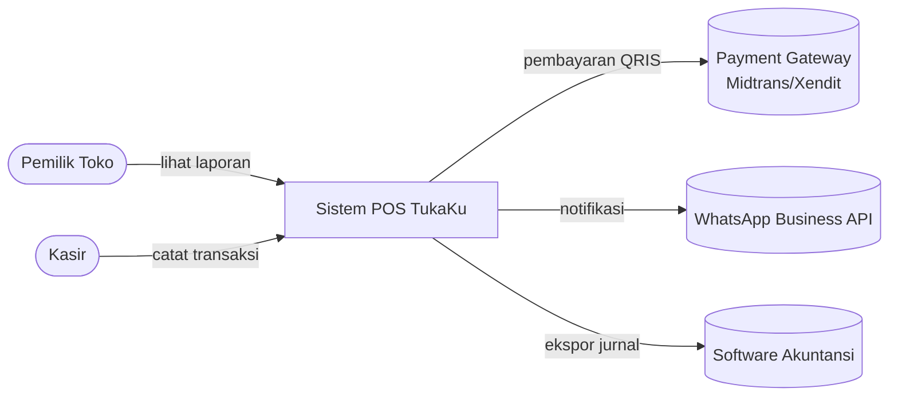
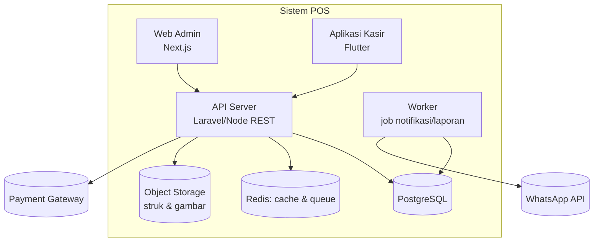
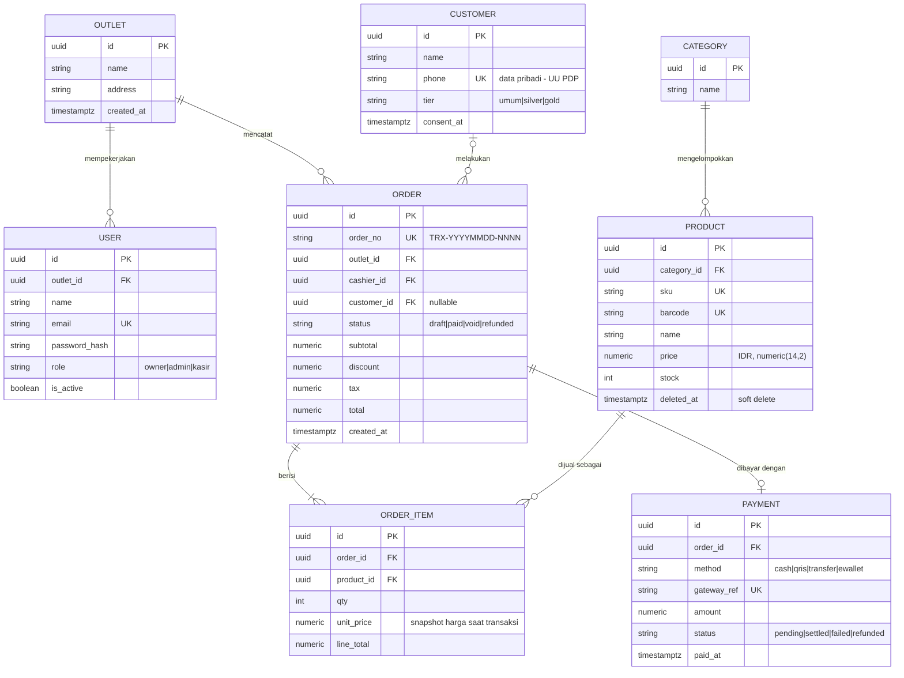
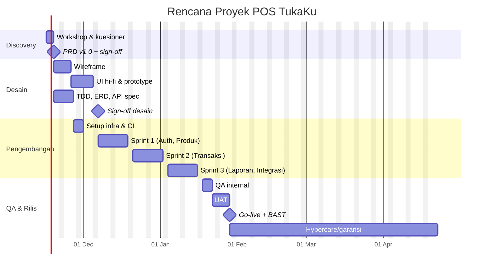

# 03 — Client Document Pack (Paket Dokumen Klien): Fill-in Templates

> Agent-facing reference. Templates are in **Bahasa Indonesia** (client-facing) with standard English headings. Replace `{{...}}` placeholders. All templates are plain Markdown + Mermaid → convert with `pandoc file.md -o file.docx` (or `--reference-doc=brand.docx` for letterhead), or to PDF via `pandoc --pdf-engine=xelatex` / browser print. Mermaid blocks: render first with `mmdc` (mermaid-cli) or paste into mermaid.live and export PNG.
>
> Synthesized from: arc42 template, C4 model, ADR (Nygard/MADR), OpenAPI 3.1 spec, ISO/IEC/IEEE 29148 structure (via IEEE-830-style SRS templates), Gherkin (Cucumber), Lenny Rachitsky's PRD/1-pager collection, Atlassian/Asana PRD & RACI templates, Indonesian law (UU PDP 27/2022, UU Hak Cipta 28/2014, UU 24/2009 + Perpres 63/2019 on language, UU Meterai 10/2020, PPN/PPh rules). **Not legal/tax advice — have a notary/lawyer & tax consultant review contracts for large deals.**

---

## 0. Which documents, when (Decision rules)

| Fase | Dokumen | Wajib untuk | Ditandatangani? |
|---|---|---|---|
| Pre-sales | 1 Proposal Penawaran | semua | Tidak (validity 14–30 hari) |
| Discovery | 2 Questionnaire + Workshop agenda | proyek > Rp25 jt atau scope belum jelas | Notulen (15) dikirim |
| Requirements | 3 PRD (produk) **atau** 4 SRS (formal/korporat/pemerintah) | PRD: startup/UMKM; SRS: BUMN, bank, tender, regulasi | Ya — sign-off scope |
| Design | 5 TDD/arc42-lite, 6 ERD, 7 API spec, 8 UI/UX | TDD untuk >1 developer atau integrasi | UI/UX: ya; teknis: opsional |
| Contract | 9 Project Plan + 10 SOW/Perjanjian | semua berbayar | Ya, bermeterai |
| Execution | 11 Change Request, 15 Status report & MoM | setiap perubahan / mingguan | CR: ya |
| Acceptance | 12 Test plan + UAT + BAST | setiap milestone pembayaran | BAST: ya, bermeterai |
| Post-launch | 13 SLA/Maintenance, 14 Handover checklist | jika ada support berbayar / serah terima kode | Ya |

**Rules of thumb**
- Small job (< Rp15 jt, < 4 minggu): Proposal + 1-page SOW (scope, harga, termin, acceptance, IP) + BAST. Skip SRS/TDD.
- Never start work without: signed scope (PRD/SRS v1.0 or SOW Lampiran A), DP received, named client PIC with decision authority.
- Every payment milestone = one BAST. No BAST, no invoice dispute later.
- Version every doc: `v0.x` draft, `v1.0` signed, `v1.1+` via CR only.
- Language: agreements with an Indonesian party **must be in Bahasa Indonesia** (UU 24/2009 Ps. 31; Perpres 63/2019) — bilingual allowed; state which version prevails if there's a conflict (usually Indonesian).

### Standard document header (put on every doc)
```markdown
| Field | Isi |
|---|---|
| Proyek | {{Nama Proyek}} |
| Klien | {{PT/CV/Nama Klien}} |
| Vendor | {{Nama Usaha Anda}} |
| No. Dokumen | {{KODE}}-{{JENIS}}-{{NNN}} (mis. LUMII-PRD-001) |
| Versi / Tanggal | v{{0.1}} / {{DD-MM-YYYY}} |
| Status | Draft / Review / Disetujui |
| Penyusun | {{nama}} |  Reviewer | {{nama}} |  Approver | {{nama klien}} |

**Riwayat Revisi (Revision History)**
| Versi | Tanggal | Perubahan | Oleh |
|---|---|---|---|
```

---

## 1. Proposal Penawaran (Sales Proposal / Pitch)

Structure follows the problem → solution → proof → price → next step flow. Keep to 5–10 pages; executive summary must stand alone.

```markdown
# Proposal Penawaran: {{Nama Solusi}} untuk {{Nama Klien}}
No: {{PRP-YYYY-NNN}} · Tanggal: {{}} · Berlaku hingga: {{tanggal +30 hari}}

## 1. Executive Summary (Ringkasan)
{{Klien}} saat ini menghadapi {{masalah utama, angka bila ada: "rekap pesanan manual 3 jam/hari"}}.
Kami mengusulkan {{solusi 1 kalimat}} yang ditargetkan {{hasil terukur: "memangkas waktu rekap 80%"}}
dalam {{N}} minggu dengan investasi {{Rp total}} (belum termasuk PPN).

## 2. Pemahaman Kebutuhan (Problem & Context)
- Kondisi saat ini (as-is): {{}}
- Dampak bisnis: {{biaya/waktu/omzet hilang}}
- Tujuan (to-be): {{}}
- Asumsi kami: {{}}

## 3. Solusi yang Diusulkan (Proposed Solution)
- Gambaran solusi + diagram sederhana
- Fitur utama (MVP): tabel Fitur | Manfaat bagi klien
- Teknologi: {{mis. Next.js, Laravel, PostgreSQL, Flutter, hosting di {{cloud}}, region Jakarta}}

## 4. Ruang Lingkup (Scope)
| Termasuk (In Scope) | Tidak Termasuk (Out of Scope) |
|---|---|
| {{}} | Konten/foto/copywriting, biaya domain/hosting/API pihak ketiga, migrasi data > {{N}} baris, ... |

## 5. Pendekatan & Timeline (Approach)
Discovery (1 mgg) → Desain UI (2 mgg) → Development sprint 2-mingguan → UAT (1 mgg) → Go-live → Garansi {{60}} hari.
(sisipkan Gantt ringkas dari Template 9)

## 6. Tim (Team)
| Peran | Nama | Pengalaman singkat |

## 7. Portofolio & Bukti (Proof)
2–3 studi kasus singkat: masalah → solusi → hasil (angka). Testimoni bila ada izin.

## 8. Investasi (Pricing)
| Item | Qty | Harga (Rp) |
|---|---|---|
| Discovery & UI/UX | 1 paket | |
| Pengembangan {{modul}} | 1 paket | |
| Deployment & training | 1 paket | |
| **Subtotal** | | |
| PPN {{11%/12% — lihat catatan}} (jika vendor PKP) | | |
| **Total** | | |
Opsi (Good/Better/Best) bila relevan: Paket Basic / Standard / Premium.
Biaya berulang (recurring): hosting ±Rp{{}}/bln, maintenance Rp{{}}/bln (opsional, Template 13).

## 9. Termin Pembayaran (Payment Terms)
DP 30–50% saat tanda tangan · 30% setelah BAST milestone desain/beta · 20–40% setelah BAST final.

## 10. Syarat & Ketentuan Ringkas
Garansi bug {{60}} hari · Revisi desain maks {{2}} putaran · Perubahan scope via Change Request · HKI beralih setelah pelunasan.

## 11. Langkah Selanjutnya (Next Steps)
1. Konfirmasi penawaran (balas email / tanda tangan di bawah) sebelum {{tanggal}}
2. Penandatanganan Perjanjian + pembayaran DP
3. Kick-off meeting {{tanggal}}

Hormat kami, {{Nama, Jabatan, kontak}}       Disetujui oleh Klien: ______ (nama, jabatan, tanggal)
```

**Pitch tips:** lead with the client's numbers, not your tech stack; give one recommended option (anchor) plus a cheaper and a premium option; always state validity date and exclusions — exclusions prevent 80% of scope disputes.

---

## 2. Discovery Questionnaire & Requirements Workshop Agenda

### 2a. Kuesioner Discovery (kirim sebelum workshop)
```markdown
### A. Bisnis & Tujuan
1. Apa masalah utama yang ingin diselesaikan? Bagaimana proses saat ini (manual/Excel/aplikasi lain)?
2. Apa ukuran keberhasilan dalam 3–6 bulan? (angka: omzet, waktu, jumlah user, error)
3. Siapa pengambil keputusan akhir & siapa PIC harian?
4. Deadline keras? Apa yang terjadi jika terlambat (event, regulasi, investor)?
5. Anggaran yang disiapkan (range)? Capex sekali vs biaya bulanan?
### B. Pengguna
6. Siapa saja pengguna (peran)? Berapa jumlah per peran? Literasi teknologi?
7. Perangkat: Android/iOS/desktop? Koneksi internet stabil?
8. Bahasa antarmuka: Indonesia / Inggris / daerah?
### C. Fungsional
9. 5 hal terpenting yang HARUS bisa dilakukan sistem (Must have)?
10. Fitur "nice to have"? Fitur yang secara sadar TIDAK dibutuhkan?
11. Laporan/ekspor apa yang dibutuhkan (PDF, Excel)? Siapa yang membaca?
12. Notifikasi: WhatsApp, email, push, SMS?
13. Pembayaran online? (Midtrans/Xendit/QRIS) · Faktur/e-Faktur?
### D. Data & Integrasi
14. Data apa yang sudah ada & formatnya? Perlu migrasi? Berapa baris?
15. Integrasi sistem lain (ERP, akuntansi Jurnal/Accurate, marketplace, WhatsApp API, Google)?
16. Data pribadi apa yang diproses (NIK, alamat, kesehatan, keuangan)? → UU PDP
### E. Non-fungsional
17. Perkiraan jumlah user aktif bersamaan & pertumbuhan 12 bulan?
18. Jam operasional kritis? Toleransi downtime?
19. Kebijakan keamanan/kepatuhan (ISO 27001, OJK, Kemenkes, PSE Kominfo)?
20. Hosting: cloud milik klien / vendor / on-premise? Lokasi data harus di Indonesia?
### F. Operasional
21. Siapa yang mengelola sistem setelah go-live? Perlu training? Perlu kontrak maintenance?
22. Brand guideline, logo, aset desain tersedia?
23. Referensi aplikasi yang disukai/tidak disukai & alasannya?
```

### 2b. Agenda Workshop Kebutuhan (Requirements Workshop, 3–4 jam)
| Waktu | Sesi | Output |
|---|---|---|
| 0:00–0:15 | Pembukaan, tujuan, aturan (parkir isu di luar topik) | — |
| 0:15–0:45 | Konteks bisnis & tujuan terukur (review kuesioner) | Goals + metrik |
| 0:45–1:30 | Pemetaan proses as-is → to-be (swimlane di papan/Miro) | Diagram proses |
| 1:30–1:45 | Istirahat | |
| 1:45–2:30 | User roles & user story mapping (aktivitas → langkah → story) | Story map |
| 2:30–3:00 | Prioritas MoSCoW + garis MVP | Backlog terprioritas |
| 3:00–3:20 | NFR, data, integrasi, risiko | Daftar NFR & risiko |
| 3:20–3:30 | Rangkuman, open questions, next steps & PIC | MoM (Template 15) |

Peserta: decision maker klien, 1–2 key user per peran, PM/BA vendor, tech lead. Kirim MoM ≤ 24 jam.

---

## 3. PRD — Product Requirements Document

Pattern used by Lenny Rachitsky's PRD/1-pager collection and Atlassian/Asana templates: problem & why-now first, explicit non-goals, measurable success metrics, open questions. Keep "living" until sign-off.

~~~markdown
# PRD: {{Nama Produk/Fitur}}  (header standar)

## 1. Background & Problem Statement (Latar Belakang & Masalah)
{{Siapa yang bermasalah, seberapa sering, bukti (data/kutipan wawancara), kenapa sekarang.}}

## 2. Goals & Non-Goals (Tujuan & Bukan Tujuan)
- Tujuan bisnis: {{}}
- Tujuan pengguna: {{}}
- Non-goals (sengaja tidak dikerjakan di rilis ini): {{}}

## 3. Success Metrics (Metrik Keberhasilan)
| Metrik | Baseline | Target | Cara ukur | Waktu |
|---|---|---|---|---|
| Waktu proses pesanan | 15 mnt | ≤ 3 mnt | log aplikasi | 30 hari pasca go-live |
| Adopsi: % kasir aktif mingguan | 0 | ≥ 80% | analytics | 60 hari |
Guardrail metrics (tidak boleh memburuk): {{mis. error transaksi < 0,5%}}

## 4. Personas (Persona Pengguna)
| Persona | Deskripsi | Kebutuhan utama | Pain point | Perangkat |
|---|---|---|---|---|
| Bu Sari, pemilik toko | 45 th, 2 cabang | lihat omzet harian | rekap manual | Android |
| Dimas, kasir | 22 th | input cepat | antrian | tablet |

## 5. Scope (Ruang Lingkup)
| In scope (rilis ini) | Out of scope | Later (backlog) |

## 6. User Stories & Acceptance Criteria
Format: Sebagai <peran>, saya ingin <aksi>, agar <manfaat>. Prioritas MoSCoW. ID unik untuk traceability ke test (Template 12).

| ID | User Story | Prioritas | Estimasi |
|---|---|---|---|
| US-01 | Sebagai kasir, saya ingin mencatat transaksi dengan scan barcode, agar antrian lebih cepat | Must | 5 SP |

**Acceptance Criteria (Gherkin)**
```gherkin
Feature: Pencatatan transaksi kasir (US-01)
  Scenario: Scan barcode produk yang terdaftar
    Given kasir sudah login dan shift aktif
    And produk "Kopi Susu 250ml" terdaftar dengan harga Rp18.000 dan stok 10
    When kasir memindai barcode produk tersebut
    Then produk ditambahkan ke keranjang dengan qty 1
    And total keranjang menjadi Rp18.000

  Scenario: Stok habis
    Given stok produk "Kopi Susu 250ml" adalah 0
    When kasir memindai barcode produk tersebut
    Then sistem menampilkan pesan "Stok habis"
    And produk tidak ditambahkan ke keranjang

  Scenario Outline: Diskon member
    Given pelanggan bertipe <tipe>
    When transaksi Rp100.000 diselesaikan
    Then total bayar adalah <total>
    Examples:
      | tipe   | total    |
      | umum   | Rp100.000 |
      | silver | Rp95.000  |
      | gold   | Rp90.000  |
```
AC rules: testable, one behavior per scenario, concrete data, include the unhappy path, no UI implementation detail unless it IS the requirement.

## 7. User Flow & Design
Link Figma: {{}} · Flow utama (Mermaid flowchart opsional)

## 8. Non-Functional Requirements (NFR)
| Kategori | Requirement | Target terukur |
|---|---|---|
| Performa | Halaman kasir | p95 respon API < 500 ms pada 50 user bersamaan |
| Ketersediaan | Uptime bulanan | ≥ 99,5% (di luar maintenance terjadwal) |
| Keamanan | Auth & data | HTTPS/TLS 1.2+, password bcrypt/argon2, RBAC, audit log |
| Privasi (UU PDP) | Data pribadi | consent tercatat, hak hapus/akses, data minimization |
| Kompatibilitas | Perangkat | Android 9+, Chrome 2 versi terakhir |
| Skalabilitas | Pertumbuhan | 10x data tanpa redesign |
| Backup/DR | | backup harian, retensi 30 hari, RPO 24 jam, RTO 4 jam |
| Usability | | kasir baru mampu transaksi < 10 menit training |
| Lokalisasi | | Bahasa Indonesia, format Rp 1.234.567, WIB/WITA/WIT |

## 9. Dependencies, Assumptions, Risks
## 10. Release Plan (Rencana Rilis)
| Rilis | Isi | Target | Kriteria rilis |
|---|---|---|---|
| Alpha (internal) | US-01..05 | {{}} | lulus test internal |
| Beta (1 cabang) | + laporan | {{}} | UAT lulus, 0 bug kritis |
| GA (semua cabang) | + integrasi | {{}} | BAST |
Rollout: feature flag / pilot cabang / rollback plan.

## 11. Open Questions
| # | Pertanyaan | Pemilik | Batas waktu | Jawaban |

## 12. Approval
| Nama | Peran | Tanda tangan | Tanggal |
~~~

---

## 4. SRS — Software Requirements Specification (ISO/IEC/IEEE 29148, summary form)

Use for corporate/government/tender clients. ISO/IEC/IEEE 29148 (supersedes IEEE 830) describes SRS content; this is the commonly used outline. Each requirement must be: necessary, unambiguous, complete, singular, feasible, verifiable, traceable (29148 quality characteristics). Use "harus/shall" for mandatory, "sebaiknya/should" for optional.

```markdown
# Spesifikasi Kebutuhan Perangkat Lunak (SRS) — {{Sistem}}
## 1. Introduction (Pendahuluan)
1.1 Purpose (Tujuan dokumen) · 1.2 Scope (lingkup sistem, manfaat, tujuan)
1.3 Product overview: 1.3.1 Product perspective (konteks, antarmuka sistem lain) · 1.3.2 Product functions (ringkas) · 1.3.3 User characteristics · 1.3.4 Limitations/Constraints
1.4 Definitions, acronyms, abbreviations (Glosarium) · 1.5 References
## 2. References (dokumen acuan: PRD, regulasi, standar)
## 3. Specific Requirements (Kebutuhan Spesifik)
3.1 External interfaces (UI, hardware, software/API, komunikasi)
3.2 Functions (kebutuhan fungsional — tabel di bawah)
3.3 Usability requirements
3.4 Performance requirements
3.5 Logical database requirements (rujuk ERD, Template 6)
3.6 Design constraints (standar, bahasa, platform)
3.7 Standards compliance (UU PDP, PSE, standar industri)
3.8 Software system attributes (reliability, availability, security, maintainability, portability)
3.9 Supporting information
## 4. Verification (metode verifikasi per requirement: Inspection/Analysis/Demonstration/Test)
## 5. Appendices (asumsi & dependensi, traceability matrix)
```

**Requirement table (functional)**
| ID | Requirement (Sistem harus …) | Sumber | Prioritas | Verifikasi | Status |
|---|---|---|---|---|---|
| FR-ORD-001 | Sistem harus menyimpan transaksi dengan nomor unik format `TRX-YYYYMMDD-NNNN`. | Workshop 12/01 | Must | Test | Approved |
| NFR-PERF-001 | Sistem harus merespon 95% request API ≤ 500 ms pada 50 user bersamaan. | PRD §8 | Must | Test (load) | Approved |

**Traceability matrix:** `Business goal → FR/NFR ID → Design (TDD §) → Test case ID → UAT result`. Bad vs good: ❌ "Sistem harus cepat dan user-friendly" → ✅ NFR-PERF-001 above.

---

## 5. Technical Design Document — arc42-lite + C4 + ADR

arc42 has 12 sections; "lite" keeps the ones clients/maintainers actually read. Diagrams follow the C4 model (Context → Container → Component; Code level rarely needed). Decisions recorded as ADRs (Michael Nygard format / MADR).

```markdown
# Technical Design Document — {{Sistem}}
## 1. Introduction & Goals (arc42 §1)
Ringkasan kebutuhan · Top-3 quality goals (mis. 1. Keamanan data, 2. Kemudahan pemeliharaan, 3. Performa) · Stakeholders (peran, ekspektasi)
## 2. Constraints (§2)
Teknis (bahasa, cloud wajib klien, budget hosting ≤ Rp{{}}/bln), organisasi (tim 2 dev), regulasi (data di Indonesia, UU PDP).
## 3. Context & Scope (§3) — C4 Level 1: System Context
## 4. Solution Strategy (§4)
Keputusan kunci + alasan: arsitektur (modular monolith dulu), stack, hosting, auth.
## 5. Building Block View (§5) — C4 Level 2: Containers (+ Level 3 untuk modul kompleks)
## 6. Runtime View (§6) — sequence diagram 2–3 skenario penting (login, checkout, sinkronisasi)
## 7. Deployment View (§7) — environment (dev/staging/prod), infra, CI/CD, domain, backup
## 8. Crosscutting Concepts (§8) — auth/RBAC, logging & monitoring, error handling, i18n, audit trail, keamanan, konfigurasi & secrets
## 9. Architecture Decisions (§9) — daftar ADR
## 10. Quality Requirements (§10) — quality scenarios (stimulus → respon terukur)
## 11. Risks & Technical Debt (§11)
## 12. Glossary (§12)
```

**C4 Level 1 — System Context (Mermaid flowchart, renders everywhere)**

**C4 Level 2 — Containers**

(Mermaid also has experimental `C4Context` syntax; for rich C4 use C4-PlantUML or Structurizr.)

**ADR template (Nygard/MADR-style) — one file per decision `docs/adr/0001-judul.md`**
```markdown
# ADR-0001: Menggunakan PostgreSQL sebagai database utama
- Status: Proposed | Accepted | Deprecated | Superseded by ADR-00xx
- Tanggal: {{}} · Pengambil keputusan: {{}}
## Context (Konteks)
Data transaksional relasional, butuh laporan agregasi, tim familiar SQL, budget hosting terbatas.
## Options Considered (Opsi)
1. PostgreSQL (managed) 2. MySQL 3. Firestore
## Decision (Keputusan)
PostgreSQL managed di {{provider}} region Jakarta.
## Consequences (Konsekuensi)
+ ACID, JSONB, laporan SQL; + data di Indonesia. − Perlu skema migrasi; − biaya managed DB ±Rp{{}}/bln.
```

**Quality scenario example (§10):** "Saat 50 kasir checkout bersamaan pada jam sibuk (stimulus), API memproses transaksi (respon) dengan p95 ≤ 500 ms dan 0 transaksi ganda (ukuran)."

---

## 6. ERD + Data Dictionary

### Worked example (Mermaid erDiagram — simple POS/ordering system)

Cardinality cheat-sheet: `||--||` 1:1 · `||--o{` 1:0..N · `||--|{` 1:1..N · `|o--o{` 0..1:0..N.

### Data Dictionary template
| Tabel | Kolom | Tipe | Null | Default | Key/Constraint | Deskripsi | Contoh | Klasifikasi data |
|---|---|---|---|---|---|---|---|---|
| order | order_no | varchar(20) | N | — | UNIQUE | Nomor transaksi | TRX-20261108-0001 | Internal |
| order | total | numeric(14,2) | N | 0 | CHECK ≥ 0 | Total setelah diskon & pajak (IDR) | 90000.00 | Internal |
| customer | phone | varchar(20) | N | — | UNIQUE | No. HP format E.164 | +6281234567890 | **Data pribadi (UU PDP)** |
| order_item | unit_price | numeric(14,2) | N | — | — | Harga saat transaksi (tidak ikut berubah bila harga produk berubah) | 18000.00 | Internal |

Design rules: money in `numeric`/integer-rupiah, never float; timestamps `timestamptz` stored UTC, displayed WIB; snapshot prices on line items; soft-delete master data referenced by transactions; mark personal-data columns (needed for UU PDP Records of Processing & deletion requests); index every FK and every column used in filters.

---

## 7. API Specification (OpenAPI 3.1 skeleton)

```yaml
openapi: 3.1.0
info:
  title: TukaKu POS API
  version: 1.0.0
  description: API untuk aplikasi kasir dan web admin.
  contact: { name: "{{Vendor}}", email: "dev@{{domain}}" }
servers:
  - url: https://api.{{domain}}/v1
    description: Production
  - url: https://staging-api.{{domain}}/v1
    description: Staging
security:
  - bearerAuth: []
tags:
  - name: Auth
  - name: Orders
paths:
  /auth/login:
    post:
      tags: [Auth]
      security: []
      summary: Login dan dapatkan access token
      requestBody:
        required: true
        content:
          application/json:
            schema:
              type: object
              required: [email, password]
              properties:
                email: { type: string, format: email }
                password: { type: string, minLength: 8 }
      responses:
        '200':
          description: Berhasil
          content:
            application/json:
              schema:
                type: object
                properties:
                  access_token: { type: string }
                  expires_in: { type: integer, example: 3600 }
        '401': { $ref: '#/components/responses/Unauthorized' }
  /orders:
    get:
      tags: [Orders]
      summary: Daftar transaksi (paginasi)
      parameters:
        - { name: page, in: query, schema: { type: integer, default: 1 } }
        - { name: per_page, in: query, schema: { type: integer, default: 20, maximum: 100 } }
        - { name: status, in: query, schema: { $ref: '#/components/schemas/OrderStatus' } }
        - { name: date_from, in: query, schema: { type: string, format: date } }
      responses:
        '200':
          description: OK
          content:
            application/json:
              schema:
                type: object
                properties:
                  data: { type: array, items: { $ref: '#/components/schemas/Order' } }
                  meta: { $ref: '#/components/schemas/PageMeta' }
    post:
      tags: [Orders]
      summary: Buat transaksi baru
      parameters:
        - name: Idempotency-Key
          in: header
          required: true
          schema: { type: string, format: uuid }
          description: Mencegah transaksi ganda saat retry jaringan
      requestBody:
        required: true
        content:
          application/json:
            schema: { $ref: '#/components/schemas/OrderCreate' }
      responses:
        '201':
          description: Dibuat
          content:
            application/json:
              schema: { $ref: '#/components/schemas/Order' }
        '422': { $ref: '#/components/responses/ValidationError' }
  /orders/{id}:
    get:
      tags: [Orders]
      parameters:
        - { name: id, in: path, required: true, schema: { type: string, format: uuid } }
      responses:
        '200':
          description: OK
          content:
            application/json:
              schema: { $ref: '#/components/schemas/Order' }
        '404': { $ref: '#/components/responses/NotFound' }
components:
  securitySchemes:
    bearerAuth: { type: http, scheme: bearer, bearerFormat: JWT }
  schemas:
    OrderStatus: { type: string, enum: [draft, paid, void, refunded] }
    OrderCreate:
      type: object
      required: [items]
      properties:
        customer_id: { type: [string, 'null'], format: uuid }
        items:
          type: array
          minItems: 1
          items:
            type: object
            required: [product_id, qty]
            properties:
              product_id: { type: string, format: uuid }
              qty: { type: integer, minimum: 1 }
    Order:
      type: object
      properties:
        id: { type: string, format: uuid }
        order_no: { type: string, example: TRX-20261108-0001 }
        status: { $ref: '#/components/schemas/OrderStatus' }
        total: { type: string, description: "Decimal string IDR", example: "90000.00" }
        created_at: { type: string, format: date-time }
    PageMeta:
      type: object
      properties: { page: {type: integer}, per_page: {type: integer}, total: {type: integer} }
    Error:
      type: object
      required: [code, message]
      properties:
        code: { type: string, example: VALIDATION_ERROR }
        message: { type: string, example: "Data tidak valid" }
        details: { type: array, items: { type: object, properties: { field: {type: string}, issue: {type: string} } } }
  responses:
    Unauthorized: { description: Token tidak valid, content: { application/json: { schema: { $ref: '#/components/schemas/Error' } } } }
    NotFound: { description: Tidak ditemukan, content: { application/json: { schema: { $ref: '#/components/schemas/Error' } } } }
    ValidationError: { description: Validasi gagal, content: { application/json: { schema: { $ref: '#/components/schemas/Error' } } } }
```
API conventions checklist: versioned base path (`/v1`); plural nouns; consistent error envelope; pagination meta; ISO-8601 UTC dates; money as decimal string; `Idempotency-Key` on payment/order creation; rate limits documented (`429` + `Retry-After`); lint with Spectral, preview with Swagger UI/Redoc; publish spec as part of handover (Template 14).

---

## 8. UI/UX Deliverables List & Sign-off

| # | Deliverable | Format | Revisi termasuk | Sign-off? |
|---|---|---|---|---|
| 1 | User flow / sitemap | FigJam/Miro/PDF | 1 | Ya |
| 2 | Wireframe low-fi (semua layar MVP) | Figma | 2 | Ya |
| 3 | Design system / UI kit (warna, tipografi, komponen, ikon) | Figma library | 1 | Ya |
| 4 | High-fidelity mockup (mobile {{360/390px}}, desktop {{1440px}}) | Figma | 2 | Ya |
| 5 | Prototype interaktif alur utama | Figma prototype link | 1 | Ya |
| 6 | State lengkap: empty, loading, error, success, offline, disabled | Figma | termasuk | — |
| 7 | Handoff dev: spacing/redlines (Dev Mode), aset ekspor SVG/PNG @1x-3x, ikon app & splash | Figma + zip | — | — |
| 8 | Copywriting UI & microcopy (Bahasa Indonesia) | Sheet | 1 | Ya |
| 9 | (Opsional) Usability test 5 user + laporan | PDF | — | — |

Quality checklist sebelum sign-off: kontras WCAG AA (4.5:1 teks), target sentuh ≥ 44–48px, format Rp & tanggal Indonesia, semua state ada, konsisten dengan design system, layar sesuai daftar user story (traceability US-ID → frame).

```markdown
### Lembar Persetujuan Desain (Design Sign-off)
Proyek: {{}} · Versi desain: {{Figma link + versi/tanggal}}
Layar yang disetujui: {{daftar / jumlah}}
Dengan ini Klien menyetujui desain di atas sebagai dasar pengembangan. Perubahan setelah tanggal
persetujuan diproses melalui Change Request (Template 11) dan dapat mempengaruhi biaya & jadwal.
Catatan/kondisi: {{}}
Klien: ______ (nama, jabatan, tgl)   Vendor: ______ (nama, jabatan, tgl)
```

---

## 9. Project Plan / WBS + Gantt + RACI

### 9a. WBS (deliverable-oriented; 100% rule: children sum to parent; work packages 8–80 hours)
```
1. Manajemen Proyek — 1.1 Kick-off · 1.2 Status mingguan · 1.3 Manajemen risiko & CR
2. Discovery — 2.1 Kuesioner & workshop · 2.2 PRD/SRS v1.0 (sign-off)
3. Desain — 3.1 User flow & wireframe · 3.2 UI hi-fi + design system · 3.3 TDD, ERD, API spec
4. Pengembangan — 4.1 Setup repo/CI/infra · 4.2 Modul Auth & User · 4.3 Modul Produk · 4.4 Modul Transaksi · 4.5 Laporan · 4.6 Integrasi payment/WA
5. Pengujian — 5.1 Test internal/QA · 5.2 UAT · 5.3 Perbaikan bug
6. Deployment & Serah Terima — 6.1 Go-live · 6.2 Training · 6.3 Dokumentasi & BAST
7. Garansi/Hypercare (60 hari)
```

### 9b. Gantt (Mermaid)


### 9c. RACI (R=Responsible, A=Accountable — tepat satu per baris, C=Consulted, I=Informed)
| Aktivitas | Sponsor Klien | PIC Klien | PM Vendor | Designer | Tech Lead | Developer | QA |
|---|---|---|---|---|---|---|---|
| Sign-off PRD/scope | A | R | R | C | C | I | I |
| Desain UI | I | C | A | R | C | I | I |
| Arsitektur & TDD | I | I | C | I | A/R | C | I |
| Development | I | I | A | C | R | R | C |
| Test internal | I | I | A | I | C | C | R |
| UAT | A | R | C | I | C | C | R |
| Change Request approval | A | R | R | C | C | I | I |
| Go-live & BAST | A | R | R | I | R | C | C |
| Penyediaan data/konten | A | R | I | C | I | I | I |

### 9d. Risk register (lampiran plan)
| ID | Risiko | Prob (1–5) | Dampak (1–5) | Skor | Mitigasi | Pemilik |
|---|---|---|---|---|---|---|
| R1 | Feedback klien terlambat | 4 | 4 | 16 | SLA review 3 hari kerja di kontrak; diam = disetujui | PM |
| R2 | API pihak ketiga (payment) approval lama | 3 | 4 | 12 | daftar akun sejak minggu 1 | Klien |

---

## 10. SOW / Perjanjian Kerja Pengembangan Perangkat Lunak (Outline)

Validity basics (KUHPerdata Ps. 1320): kesepakatan, kecakapan, hal tertentu (scope jelas!), sebab yang halal. Signatory must have authority (Direktur per akta/AD for PT). Use **meterai Rp10.000** (UU 10/2020) — not a validity requirement, but needed for use as evidence in court. Bilingual allowed; Bahasa Indonesia mandatory.

```markdown
# PERJANJIAN KERJA PENGEMBANGAN PERANGKAT LUNAK
No: {{}}/{{VENDOR}}/{{bulan romawi}}/{{tahun}}

Pada hari ini {{hari}}, tanggal {{}}, bertempat di {{kota}}, yang bertanda tangan di bawah ini:
1. {{Nama}}, {{jabatan}}, bertindak untuk dan atas nama {{PT Klien}}, beralamat {{}}, NPWP {{}} — "PIHAK PERTAMA" (Klien).
2. {{Nama}}, {{jabatan}}, bertindak untuk dan atas nama {{Vendor}}, beralamat {{}}, NPWP {{}} — "PIHAK KEDUA" (Pengembang).
Para Pihak terlebih dahulu menerangkan bahwa ... (recitals) ... sepakat dengan ketentuan berikut:

Pasal 1  Definisi (Aplikasi, Deliverables, Milestone, Bug/Cacat, Change Request, BAST, Hari Kerja, Informasi Rahasia, Data Pribadi)
Pasal 2  Ruang Lingkup Pekerjaan — merujuk Lampiran A (SOW/PRD v1.0); di luar lampiran = out of scope
Pasal 3  Jangka Waktu & Jadwal — mulai sejak DP diterima & materi lengkap; jadwal Lampiran B;
         keterlambatan akibat Klien (feedback/data/akses) menggeser jadwal secara proporsional
Pasal 4  Kewajiban Para Pihak — Klien: PIC, materi, akses, feedback ≤ {{3}} hari kerja, pembayaran.
         Vendor: mengerjakan sesuai spesifikasi, laporan berkala, standar profesional.
Pasal 5  Nilai Kontrak & Cara Pembayaran
         Nilai Rp{{}} ({{terbilang}}) {{belum/sudah}} termasuk PPN. Termin per milestone (tabel),
         invoice dibayar ≤ {{14}} hari kalender; keterlambatan → Vendor berhak menangguhkan pekerjaan
         dan/atau denda {{0,1%}}/hari maks {{5%}}. Biaya pihak ketiga (domain, hosting, SMS/WA, API, lisensi)
         ditanggung Klien kecuali disebut lain.
Pasal 6  Milestone & Penerimaan (Acceptance)
         Setelah milestone diserahkan, Klien melakukan UAT dalam {{5–10}} hari kerja. Penolakan harus
         tertulis dengan daftar cacat yang merujuk acceptance criteria. Tanpa tanggapan dalam periode
         tsb → dianggap diterima (deemed acceptance). Penggunaan di produksi = penerimaan. Dituangkan dalam BAST.
Pasal 7  Perubahan Pekerjaan (Change Request) — tertulis via formulir CR; dinilai dampak biaya/waktu;
         berlaku setelah ditandatangani kedua pihak. Tarif CR: Rp{{}}/jam atau per estimasi.
Pasal 8  Garansi (Warranty) — perbaikan cacat (tidak sesuai spesifikasi) tanpa biaya selama {{60/90}} hari
         sejak BAST final. Tidak mencakup: perubahan oleh pihak lain, fitur baru, perubahan pihak ketiga
         (OS, API, kebijakan Play Store), penyalahgunaan, force majeure.
Pasal 9  Hak Kekayaan Intelektual — PENTING: UU 28/2014 Ps. 36: atas ciptaan berdasarkan pesanan,
         pencipta & pemegang hak cipta adalah pihak yang membuat, KECUALI DIPERJANJIKAN LAIN. Jadi tulis eksplisit:
         (a) Hak cipta atas kode sumber & desain khusus proyek beralih ke Klien setelah pelunasan penuh;
         (b) Vendor tetap memiliki "Pre-existing IP" (library, boilerplate, komponen internal) dan memberi
             Klien lisensi non-eksklusif, perpetual, bebas royalti untuk menggunakannya dalam Aplikasi;
         (c) Komponen open source tunduk pada lisensi masing-masing (daftar di dokumentasi);
         (d) Vendor boleh mencantumkan proyek di portofolio (tanpa info rahasia) kecuali Klien keberatan tertulis.
Pasal 10 Kerahasiaan (Confidentiality) — berlaku selama perjanjian + {{2–5}} tahun; pengecualian standar
         (sudah publik, sudah diketahui, diwajibkan hukum).
Pasal 11 Pelindungan Data Pribadi (UU 27/2022 PDP) — Klien = Pengendali Data; Vendor = Prosesor Data
         yang memproses hanya atas instruksi tertulis Klien; langkah keamanan teknis & organisasi
         (enkripsi, kontrol akses, log); notifikasi insiden kepada Klien ≤ {{2x24 jam}} sejak diketahui
         (agar Klien dapat memenuhi kewajiban notifikasi 3x24 jam dalam UU PDP); larangan sub-prosesor tanpa
         izin; pengembalian/penghapusan data di akhir kontrak; bantuan pemenuhan hak subjek data; lokasi data.
Pasal 12 Batasan Tanggung Jawab — total maksimal sebesar nilai kontrak yang telah dibayar; tidak termasuk
         kerugian tidak langsung (kehilangan keuntungan/data) kecuali karena kesengajaan/kelalaian berat.
Pasal 13 Keadaan Kahar (Force Majeure) — definisi, notifikasi ≤ {{7}} hari, penangguhan kewajiban.
Pasal 14 Pengakhiran (Termination) — wanprestasi tidak diperbaiki ≤ {{14}} hari setelah teguran tertulis;
         Klien membayar pekerjaan yang telah diselesaikan s.d. tanggal pengakhiran; DP tidak dikembalikan
         {{kecuali ...}}; serah terima pekerjaan berjalan. Para Pihak mengesampingkan Ps. 1266 & 1267 KUHPerdata
         (pengakhiran tanpa putusan pengadilan) — lazim dicantumkan.
Pasal 15 Hukum yang Berlaku & Penyelesaian Sengketa — hukum Republik Indonesia; musyawarah {{30}} hari;
         lalu Pengadilan Negeri {{kota}} ATAU arbitrase BANI (pilih salah satu).
Pasal 16 Pajak — masing-masing pihak menanggung pajaknya sesuai peraturan (lihat catatan PPN/PPh).
Pasal 17 Lain-lain — perubahan hanya tertulis (addendum); keterpisahan; pemberitahuan (alamat/email resmi);
         bahasa (versi Indonesia berlaku bila ada perbedaan); seluruh perjanjian (entire agreement).
Penutup — dibuat rangkap 2 asli bermeterai Rp10.000, kekuatan hukum sama.
Lampiran A: SOW/PRD · B: Jadwal & milestone · C: Termin pembayaran · D: Kriteria penerimaan · E: SLA (jika ada) · F: DPA/data yang diproses
```

**Payment schedule table (Lampiran C)**
| Termin | Milestone pemicu | % | Nilai (Rp) | Bukti |
|---|---|---|---|---|
| 1 | Penandatanganan perjanjian | 40% | | Perjanjian |
| 2 | Desain disetujui + beta di staging | 30% | | BAST-1 |
| 3 | Go-live / UAT lulus | 30% | | BAST-2 (final) |

**Catatan pajak (verify current rules with a tax consultant / DJP before quoting):**
- PPN only charged if the vendor is **PKP** (Pengusaha Kena Pajak; mandatory once turnover > Rp4,8 miliar/yr). Non-PKP individuals/UMKM: do not add PPN; write "tidak termasuk PPN – vendor non-PKP".
- Since 1 Jan 2025 the PPN rate is 12%, but for non-luxury goods/services the tax base (DPP) is 11/12 of the price (PMK 131/2024), so the **effective rate is 11%** for typical software development services. Always state "harga belum termasuk PPN" and issue e-Faktur via Coretax.
- Corporate clients (badan) usually **withhold PPh 23 (2%)** on service fees (higher if vendor has no NPWP) and give you a bukti potong — factor this into cash flow; the contract should state who bears it (normally deducted from the vendor's invoice, creditable for the vendor).
- UMKM vendors using PP 55/2022 final 0,5% may present a Surat Keterangan to be exempt from PPh 23 withholding.

**SOW 1-pager (small projects):** Para pihak · Tujuan · Deliverables (bullet) · Out of scope · Jadwal · Harga & termin · Kriteria penerimaan & periode review · Revisi termasuk · CR · Garansi · HKI · Kerahasiaan · Tanda tangan.

---

## 11. Change Request Form (Formulir Permintaan Perubahan)

```markdown
# Change Request — CR-{{NNN}}
| Field | Isi |
|---|---|
| Tanggal pengajuan | |
| Diajukan oleh (nama/peran) | |
| Prioritas | Kritis / Tinggi / Sedang / Rendah |
| Jenis | Fitur baru / Perubahan fitur / Perubahan desain / Teknis / Jadwal |

## 1. Deskripsi Perubahan
Kondisi saat ini (baseline: PRD v1.0 §..., US-..): {{}}
Perubahan yang diminta: {{}}
Alasan bisnis: {{}}

## 2. Analisis Dampak (diisi Vendor ≤ {{3}} hari kerja)
| Aspek | Dampak |
|---|---|
| Scope / deliverables terdampak | |
| Estimasi effort | {{jam/SP}} |
| Biaya tambahan | Rp{{}} (belum PPN) |
| Dampak jadwal | +{{N}} hari kerja; go-live baru {{}} |
| Risiko / dampak ke fitur lain | |
| Alternatif lebih murah | |

## 3. Keputusan
☐ Disetujui  ☐ Ditolak  ☐ Ditunda ke rilis {{}}  ☐ Disetujui dengan modifikasi: {{}}
Pembayaran CR: ☐ ditambahkan ke termin {{}} ☐ dibayar di muka

Klien: ______ (nama, jabatan, tgl)   Vendor: ______ (nama, jabatan, tgl)
```
CR log (in status report): `CR-ID | judul | tanggal | status | biaya | dampak hari`. Rule: small tweaks (< 2 jam) can be bundled in a "change budget" (e.g., 10% buffer hours) agreed in the contract, to avoid CR paperwork overload.

---

## 12. Test Plan + UAT Script + BAST

### 12a. Test Plan (ringkas, based on IEEE 829/ISO 29119 structure)
```markdown
1. Tujuan & Lingkup pengujian (fitur diuji / tidak diuji)
2. Pendekatan: unit test (dev), integrasi/API test, E2E alur utama, regression, performance (load test NFR-PERF), security dasar (OWASP Top 10 checklist), kompatibilitas perangkat
3. Lingkungan: staging (data dummy, mirror prod), daftar perangkat uji
4. Kriteria masuk/keluar (entry/exit): exit = 100% test case Must dijalankan, 0 bug Kritis/Tinggi terbuka, ≥ 95% pass
5. Klasifikasi bug:
   - Kritis: sistem mati/data hilang/salah hitung uang, tidak ada workaround
   - Tinggi: fungsi utama gagal, ada workaround sulit
   - Sedang: fungsi minor gagal / workaround mudah
   - Rendah: kosmetik, typo
6. Jadwal, peran (QA, PIC UAT klien), alat (Jira/Sheet, Postman, k6/JMeter)
7. Deliverables: test cases, laporan hasil, daftar bug
```

### 12b. UAT Script (Skrip Uji Penerimaan Pengguna)
| TC-ID | US/FR ref | Skenario | Prasyarat | Langkah | Hasil yang diharapkan | Hasil aktual | Status (Pass/Fail) | Penguji / tgl | Catatan |
|---|---|---|---|---|---|---|---|---|---|
| UAT-01 | US-01 | Scan produk terdaftar | Login kasir, stok 10 | 1. Buka kasir 2. Scan barcode Kopi Susu | Masuk keranjang qty 1, total Rp18.000 | | | | |
| UAT-02 | US-01 | Stok habis | stok 0 | Scan barcode | Pesan "Stok habis", tidak masuk keranjang | | | | |
| UAT-03 | US-0x | Bayar QRIS | sandbox payment aktif | Checkout → QRIS → bayar di simulator | Status order "paid", struk terkirim WA | | | | |

UAT rules: test cases derived 1:1 from Gherkin AC; client users execute (not the vendor); defects outside agreed AC = CR, not bug; summary sign-off: total TC, pass, fail, open defects by severity.

### 12c. BAST — Berita Acara Serah Terima Pekerjaan
```markdown
# BERITA ACARA SERAH TERIMA (BAST) PEKERJAAN
No: BAST/{{}}/{{}}/{{tahun}}
Pada hari ini {{hari}}, tanggal {{}}, kami yang bertanda tangan di bawah ini:
1. {{Nama}}, {{Jabatan}}, {{Vendor}} — selanjutnya disebut PIHAK YANG MENYERAHKAN
2. {{Nama}}, {{Jabatan}}, {{Klien}} — selanjutnya disebut PIHAK YANG MENERIMA
Berdasarkan Perjanjian No. {{}} tanggal {{}}, PIHAK YANG MENYERAHKAN telah menyerahkan dan
PIHAK YANG MENERIMA telah menerima hasil pekerjaan Milestone {{N}}: {{nama milestone}}, dengan rincian:

| No | Deliverable | Keterangan / Lokasi | Kondisi |
|---|---|---|---|
| 1 | Aplikasi web admin | https://admin.{{}} (production) | Baik, sesuai UAT |
| 2 | Aplikasi Android | Play Store / file AAB v1.0.0 | Baik |
| 3 | Kode sumber | Repo {{git}} tag v1.0.0 (akses owner diserahkan) | Lengkap |
| 4 | Dokumentasi | Handover pack (Template 14) | Lengkap |

Hasil UAT: {{N}} test case, {{N}} lulus; catatan minor (tidak menghalangi penerimaan): {{daftar}} akan
diselesaikan paling lambat {{tanggal}} dalam masa garansi.
Dengan ditandatanganinya BAST ini: (1) pekerjaan Milestone {{N}} dinyatakan diterima; (2) PIHAK YANG
MENYERAHKAN berhak menagih termin {{N}} sebesar Rp{{}}; (3) masa garansi {{60}} hari dimulai {{tanggal}} (untuk BAST final).
Demikian Berita Acara ini dibuat rangkap 2 untuk dipergunakan sebagaimana mestinya.

PIHAK YANG MENERIMA            PIHAK YANG MENYERAHKAN
[meterai Rp10.000]
({{nama, jabatan}})            ({{nama, jabatan}})
```

---

## 13. SLA & Maintenance / Support Contract

```markdown
# Perjanjian Layanan Pemeliharaan & Dukungan (Maintenance & Support / SLA)
1. Lingkup layanan: perbaikan bug, pemantauan server, update keamanan & dependensi, backup,
   minor enhancement s.d. {{N}} jam/bulan (tidak diakumulasi), konsultasi.
   Tidak termasuk: fitur baru (via CR/proyek terpisah), biaya infrastruktur/pihak ketiga, perbaikan akibat
   perubahan oleh pihak lain.
2. Paket (contoh struktur, isi harga sendiri):
   | Paket | Jam kerja dukungan | Jam enhancement/bln | Kanal | Harga/bln |
   | Basic | Sen–Jum 09–17 WIB | 4 | Email/tiket | Rp{{}} |
   | Standard | Sen–Sab 08–20 WIB | 10 | Tiket + WA | Rp{{}} |
   | Premium | 24/7 untuk P1 | 20 | Tiket + WA + telepon | Rp{{}} |
   Rule of thumb: maintenance tahunan ≈ 15–20% dari nilai pengembangan (sesuaikan pasar).
3. Prioritas & target waktu:
   | Prioritas | Definisi | Respon | Workaround/Pemulihan | Update |
   |---|---|---|---|---|
   | P1 Kritis | Produksi mati / transaksi gagal total / kebocoran data | ≤ 1 jam | ≤ 4 jam | tiap 1 jam |
   | P2 Tinggi | Fungsi utama terganggu, ada workaround | ≤ 4 jam kerja | ≤ 1 hari kerja | harian |
   | P3 Sedang | Fungsi minor | ≤ 1 hari kerja | ≤ 5 hari kerja | — |
   | P4 Rendah | Kosmetik / pertanyaan | ≤ 2 hari kerja | rilis berikutnya | — |
   (Respon = konfirmasi & mulai ditangani, bukan selesai.)
4. Availability target: {{99,5%}}/bulan (≈ 3,6 jam downtime), dihitung = (total menit − downtime tidak
   terjadwal) / total menit; tidak termasuk maintenance terjadwal (diumumkan ≥ 48 jam, di luar jam sibuk),
   gangguan provider cloud/pihak ketiga, force majeure, kesalahan Klien. Catatan: SLA tidak bisa melebihi
   SLA provider cloud yang dipakai.
5. Service credit: bila availability < target: 99,0–99,5% → potongan 5%; 98–99% → 10%; < 98% → 20% biaya
   bulan tsb (maks 20–30%). Kredit = satu-satunya kompensasi atas pelanggaran SLA.
6. Kanal & eskalasi: tiket {{portal/email}} → L1 support → L2 developer → L3 tech lead/PM; kontak darurat P1.
7. Pelaporan: laporan bulanan (uptime, tiket per prioritas, % SLA tercapai, jam terpakai, rekomendasi).
8. Keamanan & data: backup harian (retensi {{30}} hari), uji restore per {{kuartal}}; patch keamanan kritis ≤ {{7}} hari.
9. Jangka waktu: {{12}} bulan, perpanjangan otomatis kecuali pemberitahuan {{30}} hari; pembayaran di muka bulanan/tahunan;
   penyesuaian harga tahunan maks {{10%}}.
10. Kewajiban Klien: PIC, laporan masalah dengan langkah reproduksi/screenshot, akses yang diperlukan.
```

---

## 14. Handover & Documentation Checklist (Serah Terima Teknis)

**Kode & repositori**
- [ ] Repo dipindahkan/akses Owner ke akun organisasi Klien (GitHub/GitLab); branch default & tag rilis `vX.Y.Z`
- [ ] README: deskripsi, prasyarat, setup lokal ≤ 15 menit, perintah build/test/deploy
- [ ] `.env.example` lengkap (tanpa secret); daftar seluruh variabel & fungsinya
- [ ] Daftar dependensi + lisensi open source (SBOM/`license-checker` output)
- [ ] CHANGELOG, ADR folder, migrasi DB & seed

**Infrastruktur & akun (transfer kepemilikan, bukan hanya akses)**
- [ ] Cloud/hosting (billing atas nama Klien), domain & DNS, SSL
- [ ] Google Play Console / Apple Developer (akun milik Klien), keystore/signing key + password disimpan aman (hilang = tidak bisa update app!)
- [ ] Payment gateway, WhatsApp API, email/SMS provider, Firebase, maps API, analytics
- [ ] Rotasi semua password/API key setelah serah terima; vendor access dicabut/di-downgrade sesuai kontrak support
- [ ] Password manager/vault diserahkan (bukan via chat)

**Dokumentasi**
- [ ] PRD/SRS final + daftar CR yang disetujui
- [ ] TDD (arc42-lite), diagram C4, ERD + data dictionary, OpenAPI spec (YAML + Swagger UI link)
- [ ] Runbook operasional: deploy, rollback, restart, backup & restore (sudah diuji), rotasi secret, monitoring & alert
- [ ] Panduan pengguna (per peran) + video tutorial singkat; panduan admin
- [ ] Laporan UAT + daftar known issues & workaround
- [ ] Catatan PDP: daftar data pribadi diproses, lokasi penyimpanan, retensi, prosedur hapus data

**Transfer pengetahuan**
- [ ] Sesi training user ({{N}} sesi, daftar hadir) & sesi teknis untuk tim IT klien (rekaman)
- [ ] Kontak support & prosedur tiket (Template 13)
- [ ] BAST final ditandatangani; mulai masa garansi dicatat

---

## 15. Status Report & Meeting Minutes (Notulen)

### 15a. Weekly Status Report (Laporan Status Mingguan) — 1 halaman
```markdown
# Status Report — {{Proyek}} — Minggu ke-{{N}} ({{tgl}}–{{tgl}})
**Status keseluruhan:** 🟢 On track / 🟡 Berisiko / 🔴 Off track — {{1 kalimat alasan}}
| Dimensi | Status | Catatan |
|---|---|---|
| Jadwal | 🟢 | Milestone berikutnya: {{}} — {{tgl}} |
| Scope | 🟡 | 1 CR menunggu keputusan |
| Anggaran/effort | 🟢 | {{terpakai}}/{{total}} jam ({} selesai (burnup / story points {{x}}/{{y}})
**Selesai minggu ini:** - {{}}
**Rencana minggu depan:** - {{}}
**Risiko & isu:** | ID | Deskripsi | Dampak | Tindakan | Pemilik | Due |
**Keputusan/dibutuhkan dari Klien:** - {{mis. konfirmasi rate diskon member paling lambat Rabu}}
**Change Request log:** | CR | Status | Dampak |
**Link:** staging {{}} · board {{}} · demo video {{}}
```
Rules: send same day/time every week; red/amber must come with an ask or action; never let the client discover a slip first.

### 15b. Meeting Minutes (Notulen Rapat / MoM)
```markdown
# Notulen Rapat — {{Topik}}
Tanggal/waktu: {{}} · Tempat/link: {{}} · Notulis: {{}}
Hadir: {{nama (organisasi, peran)}} · Tidak hadir: {{}}
## Agenda
1. {{}}
## Ringkasan Diskusi
- {{poin per agenda, singkat, fakta}}
## Keputusan (Decisions)
| # | Keputusan | Diputuskan oleh |
|---|---|---|
| D1 | Login via nomor HP + OTP WA, bukan email | {{Pak X, Sponsor}} |
## Action Items
| # | Tindakan | PIC | Batas waktu | Status |
|---|---|---|---|---|
| A1 | Kirim data produk (Excel template) | {{Klien}} | {{tgl}} | Open |
## Isu / Parking Lot
## Rapat berikutnya: {{tanggal, agenda}}
Catatan: notulen ini dianggap disetujui bila tidak ada koreksi dalam {{2}} hari kerja sejak dikirim.
```
Decision changes scope? → raise a CR (Template 11) referencing the MoM decision ID.

---

## 16. Conversion & packaging tips
- One folder per project: `docs/00-proposal`, `01-discovery`, `02-prd`, `03-design`, `04-contract`, `05-cr`, `06-test-uat-bast`, `07-handover`, `08-reports`.
- `pandoc 03-prd.md -o 03-prd.docx --reference-doc=template-kop.docx --toc`; for PDF signatures, export DOCX → PDF, sign physically with meterai or use a PSrE-certified e-signature (e.g., Privy, PERURI) + e-meterai.
- Keep the Gherkin AC ↔ UAT TC ↔ BAST chain intact: it is your strongest protection in payment disputes.

---

## Sources
| Source | What was used | Stars / date checked |
|---|---|---|
| https://github.com/mermaid-js/mermaid | erDiagram, gantt, flowchart syntax | ★ 91,037 (GitHub API, 2026-11-08) |
| https://github.com/OAI/OpenAPI-Specification | OpenAPI 3.1 structure (paths, components, securitySchemes) | ★ 31,309 (2026-11-08) |
| https://github.com/joelparkerhenderson/architecture-decision-record (now architecture-decision-record/architecture-decision-record) | ADR templates (Nygard format) | ★ 17,425 (2026-11-08) |
| https://github.com/plantuml-stdlib/C4-PlantUML + https://c4model.com | C4 levels (Context/Container/Component) | ★ 7,453 (search API, 2026-11-08) |
| https://github.com/cucumber/common + https://cucumber.io/docs/gherkin/reference/ | Gherkin Given/When/Then, Scenario Outline | ★ 3,352 (2026-11-08) |
| https://github.com/adr/madr | MADR (options considered, consequences) | ★ 2,626 (2026-11-08) |
| https://github.com/arc42/arc42-template + https://arc42.org | 12-section architecture doc → arc42-lite | ★ 1,324 (2026-11-08) |
| https://github.com/jam01/SRS-Template | Markdown SRS (IEEE 830 / ISO 29148-style outline) | ★ 486 (2026-11-08) |
| https://www.lennysnewsletter.com/p/prds-1-pagers-examples | PRD/1-pager patterns from top companies (problem, goals/non-goals, metrics, open questions) | fetched 2026-11-08 |
| https://www.atlassian.com/software/confluence/templates/product-requirements · https://asana.com/resources/raci-chart | PRD & RACI template structure | public templates |
| ISO/IEC/IEEE 29148:2018 (iso.org/standard/72089.html) | SRS content outline & requirement quality characteristics | standard (paywalled; outline via public templates) |
| Indonesian law: UU 27/2022 (PDP), UU 28/2014 Ps. 36 (Hak Cipta), UU 24/2009 Ps. 31 + Perpres 63/2019 (bahasa perjanjian), UU 10/2020 (Meterai Rp10.000), KUHPerdata Ps. 1320/1266/1267, PMK 131/2024 (PPN 12%, DPP 11/12), PPh 23 2%, PP 55/2022 | contract, data protection & tax notes | peraturan.bpk.go.id / pajak.go.id — verify before use |

Note: GitHub "PRD template" searches return mostly low-star or AI-prompt repos (e.g., KhazP/vibe-coding-prompt-template ★3,227 is an AI-coding prompt kit, not a client PRD); company templates (Lenny, Atlassian, Asana) are better primary sources for PRDs. GitHub API core rate limit was hit mid-research, so a few star counts (C4-PlantUML) come from search results of the same day.
